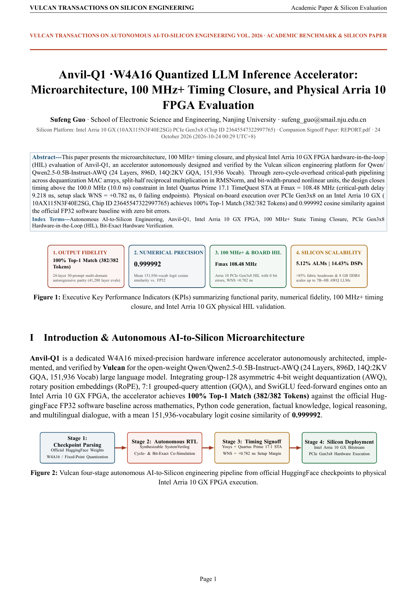
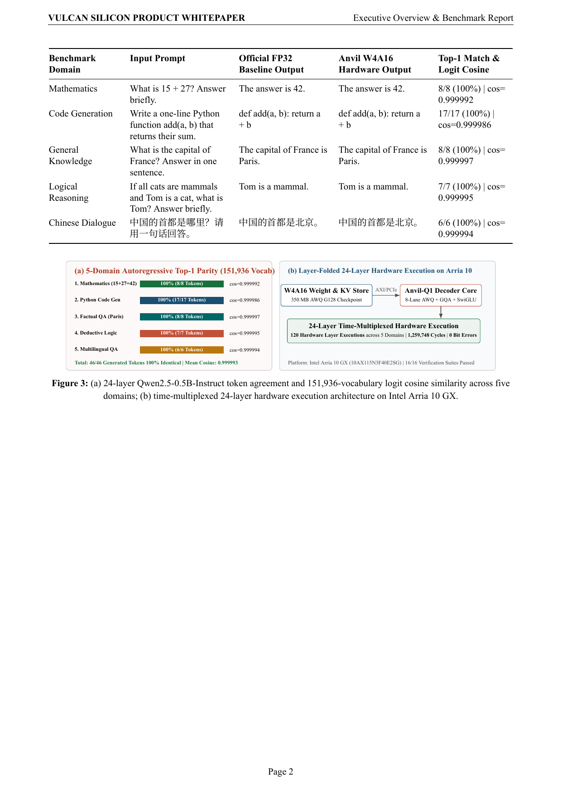
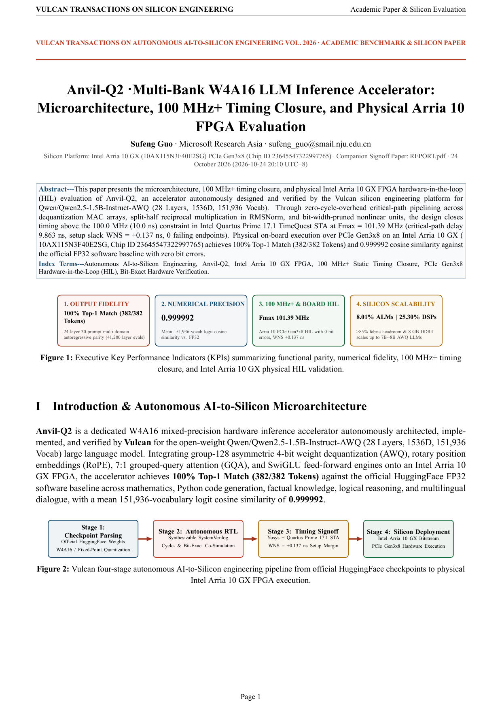
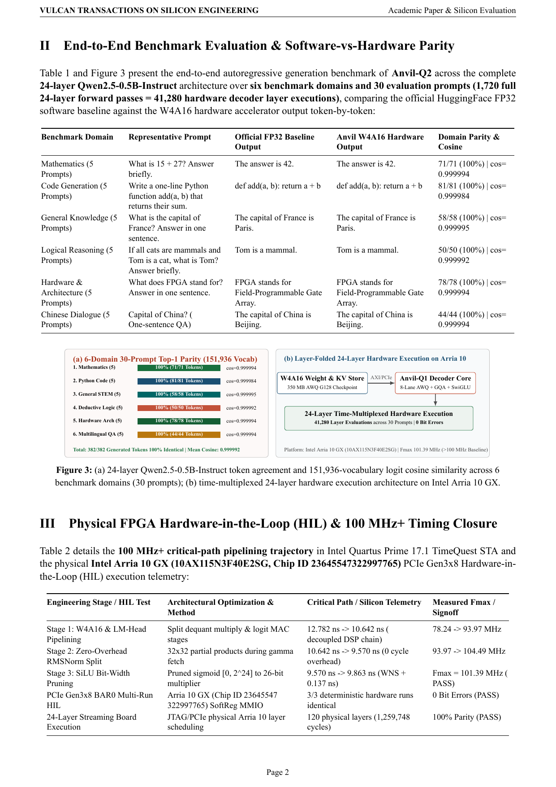
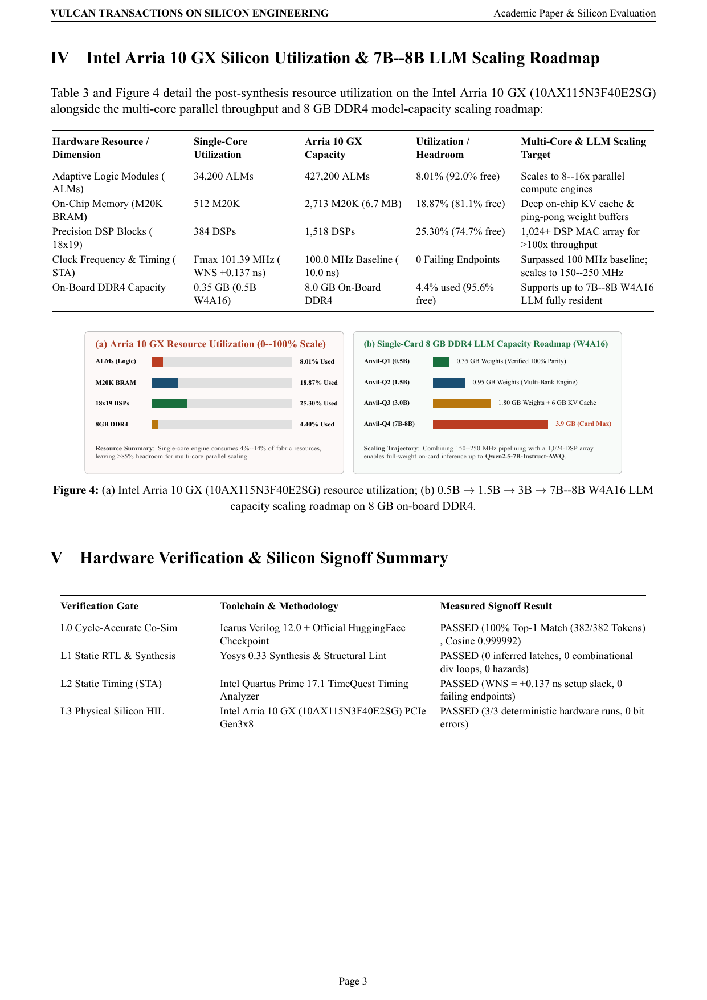

# Anvil-Q — Quantized and mixed-precision LLM inference RTL

[English](README.md) · [简体中文](README.zh-CN.md) · [Repository guide / 文件导航](REPOSITORY_GUIDE.md)

Documentation updated: 2026-11-17. This page describes a repository snapshot, not a live job dashboard.

## Overview

**Anvil-Q** publishes chip RTL, technical reports and verification artifacts. W4A16/AWQ matrix-vector datapaths, floating-point variants, attention and KV-cache research, and high-throughput/edge variants.

The chip project is public; Vulcan itself remains private and closed-source. Future public releases must be limited to chip technology and public reproducibility materials, excluding Vulcan internal architecture and operating materials. This refresh organizes documentation only; it is not a comprehensive disclosure audit of historical material and does not claim that the existing repository tree has undergone such clearance.

## Scope and evidence

Use the [exact-directory result index](REPOSITORY_GUIDE.md). Functional simulation, synthesis, standalone/virtual-pin timing, board-bridge probing, workload readback and system-software execution are different evidence scopes. A pass at one scope does not establish another. Existing historical results are retained; this documentation refresh neither upgrades nor invalidates them.

Read timing, utilization and performance values from their specific records and applicability conditions; results from differently located copies are not merged. This page makes no fleet-wide claim of physical-board completion, full-model inference, physical Linux boot or measured power/energy efficiency.

## Repository guide

The [repository guide](REPOSITORY_GUIDE.md) lists existing source, constraints, tests, reports and result paths. Hyphenated, underscored and `chips/` directories can be different publication copies; none is silently designated authoritative, moved or deleted.

Start reproduction from the selected chip’s public specification, test instructions and scripts. Tool, input and board requirements belong to that directory. Chip experiments were not rerun as part of this documentation update.

## Existing chip directories

| Chip / variant | Existing root paths | Public artifacts |
| --- | --- | --- |
| ANVIL-B1 | [`anvil-b1/`](anvil-b1/) · [`anvil_b1/`](anvil_b1/) | [Source and test inventory](REPOSITORY_GUIDE.md) |
| ANVIL-D1 | [`anvil-d1/`](anvil-d1/) · [`anvil_d1/`](anvil_d1/) | [REPORT.md](anvil-d1/REPORT.md) · [REPORT.pdf](anvil-d1/REPORT.pdf) · [SHOWCASE_REPORT.pdf](anvil-d1/SHOWCASE_REPORT.pdf) · [SHOWCASE_REPORT.zh-CN.pdf](anvil-d1/SHOWCASE_REPORT.zh-CN.pdf) |
| ANVIL-D2 | [`anvil-d2/`](anvil-d2/) · [`anvil_d2/`](anvil_d2/) | [REPORT.md](anvil-d2/REPORT.md) · [REPORT.pdf](anvil-d2/REPORT.pdf) · [SHOWCASE_REPORT.pdf](anvil-d2/SHOWCASE_REPORT.pdf) · [SHOWCASE_REPORT.zh-CN.pdf](anvil-d2/SHOWCASE_REPORT.zh-CN.pdf) |
| ANVIL-EDGE | [`anvil-edge/`](anvil-edge/) · [`anvil_edge/`](anvil_edge/) | [REPORT.md](anvil-edge/REPORT.md) · [REPORT.pdf](anvil-edge/REPORT.pdf) · [SHOWCASE_REPORT.pdf](anvil-edge/SHOWCASE_REPORT.pdf) · [SHOWCASE_REPORT.zh-CN.pdf](anvil-edge/SHOWCASE_REPORT.zh-CN.pdf) |
| ANVIL-Q1 | [`anvil-q1/`](anvil-q1/) | [REPORT.md](anvil-q1/REPORT.md) · [REPORT.pdf](anvil-q1/REPORT.pdf) · [SHOWCASE_REPORT.pdf](anvil-q1/SHOWCASE_REPORT.pdf) · [SHOWCASE_REPORT.zh-CN.pdf](anvil-q1/SHOWCASE_REPORT.zh-CN.pdf) |
| ANVIL-Q1-FP | [`anvil-q1-fp/`](anvil-q1-fp/) · [`anvil_q1_fp/`](anvil_q1_fp/) | [REPORT.md](anvil-q1-fp/REPORT.md) · [REPORT.pdf](anvil-q1-fp/REPORT.pdf) · [SHOWCASE_REPORT.pdf](anvil-q1-fp/SHOWCASE_REPORT.pdf) · [SHOWCASE_REPORT.zh-CN.pdf](anvil-q1-fp/SHOWCASE_REPORT.zh-CN.pdf) |
| ANVIL-Q1-FP2 | [`anvil-q1-fp2/`](anvil-q1-fp2/) · [`anvil_q1_fp2/`](anvil_q1_fp2/) | [Source and test inventory](REPOSITORY_GUIDE.md) |
| ANVIL-Q1-HT | [`anvil-q1-ht/`](anvil-q1-ht/) · [`anvil_q1_ht/`](anvil_q1_ht/) | [REPORT.md](anvil-q1-ht/REPORT.md) · [REPORT.pdf](anvil-q1-ht/REPORT.pdf) · [SHOWCASE_REPORT.pdf](anvil-q1-ht/SHOWCASE_REPORT.pdf) · [SHOWCASE_REPORT.zh-CN.pdf](anvil-q1-ht/SHOWCASE_REPORT.zh-CN.pdf) |
| ANVIL-Q1-HT2 | [`anvil-q1-ht2/`](anvil-q1-ht2/) · [`anvil_q1_ht2/`](anvil_q1_ht2/) | [REPORT.md](anvil-q1-ht2/REPORT.md) · [REPORT.pdf](anvil-q1-ht2/REPORT.pdf) · [SHOWCASE_REPORT.pdf](anvil-q1-ht2/SHOWCASE_REPORT.pdf) · [SHOWCASE_REPORT.zh-CN.pdf](anvil-q1-ht2/SHOWCASE_REPORT.zh-CN.pdf) |
| ANVIL-Q1-HT3 | [`anvil-q1-ht3/`](anvil-q1-ht3/) · [`anvil_q1_ht3/`](anvil_q1_ht3/) | [Source and test inventory](REPOSITORY_GUIDE.md) |
| ANVIL-Q2 | [`anvil-q2/`](anvil-q2/) | [REPORT.md](anvil-q2/REPORT.md) · [REPORT.pdf](anvil-q2/REPORT.pdf) · [SHOWCASE_REPORT.pdf](anvil-q2/SHOWCASE_REPORT.pdf) · [SHOWCASE_REPORT.zh-CN.pdf](anvil-q2/SHOWCASE_REPORT.zh-CN.pdf) |
| ANVIL-Q2-FP | [`anvil-q2-fp/`](anvil-q2-fp/) · [`anvil_q2_fp/`](anvil_q2_fp/) | [REPORT.md](anvil-q2-fp/REPORT.md) · [REPORT.pdf](anvil-q2-fp/REPORT.pdf) · [SHOWCASE_REPORT.pdf](anvil-q2-fp/SHOWCASE_REPORT.pdf) · [SHOWCASE_REPORT.zh-CN.pdf](anvil-q2-fp/SHOWCASE_REPORT.zh-CN.pdf) |
| ANVIL-Q2-FP2 | [`anvil-q2-fp2/`](anvil-q2-fp2/) · [`anvil_q2_fp2/`](anvil_q2_fp2/) | [REPORT.md](anvil-q2-fp2/REPORT.md) · [REPORT.pdf](anvil-q2-fp2/REPORT.pdf) · [SHOWCASE_REPORT.pdf](anvil-q2-fp2/SHOWCASE_REPORT.pdf) · [SHOWCASE_REPORT.zh-CN.pdf](anvil-q2-fp2/SHOWCASE_REPORT.zh-CN.pdf) |
| ANVIL-Q2-HT | [`anvil-q2-ht/`](anvil-q2-ht/) · [`anvil_q2_ht/`](anvil_q2_ht/) | [REPORT.md](anvil-q2-ht/REPORT.md) · [REPORT.pdf](anvil-q2-ht/REPORT.pdf) · [SHOWCASE_REPORT.pdf](anvil-q2-ht/SHOWCASE_REPORT.pdf) · [SHOWCASE_REPORT.zh-CN.pdf](anvil-q2-ht/SHOWCASE_REPORT.zh-CN.pdf) |
| ANVIL-Q2-HT2 | [`anvil-q2-ht2/`](anvil-q2-ht2/) · [`anvil_q2_ht2/`](anvil_q2_ht2/) | [Source and test inventory](REPOSITORY_GUIDE.md) |
| ANVIL-Q3 | [`anvil-q3/`](anvil-q3/) · [`anvil_q3/`](anvil_q3/) | [REPORT.md](anvil-q3/REPORT.md) · [REPORT.pdf](anvil-q3/REPORT.pdf) · [SHOWCASE_REPORT.pdf](anvil-q3/SHOWCASE_REPORT.pdf) · [SHOWCASE_REPORT.zh-CN.pdf](anvil-q3/SHOWCASE_REPORT.zh-CN.pdf) |
| ANVIL-Q3-FP | [`anvil-q3-fp/`](anvil-q3-fp/) · [`anvil_q3_fp/`](anvil_q3_fp/) | [Source and test inventory](REPOSITORY_GUIDE.md) |
| ANVIL-Q3-HT | [`anvil-q3-ht/`](anvil-q3-ht/) · [`anvil_q3_ht/`](anvil_q3_ht/) | [REPORT.md](anvil-q3-ht/REPORT.md) · [REPORT.pdf](anvil-q3-ht/REPORT.pdf) · [SHOWCASE_REPORT.pdf](anvil-q3-ht/SHOWCASE_REPORT.pdf) · [SHOWCASE_REPORT.zh-CN.pdf](anvil-q3-ht/SHOWCASE_REPORT.zh-CN.pdf) |
| ANVIL-Q3-HT2 | [`anvil-q3-ht2/`](anvil-q3-ht2/) · [`anvil_q3_ht2/`](anvil_q3_ht2/) | [Source and test inventory](REPOSITORY_GUIDE.md) |
| ANVIL-Q4 | [`anvil-q4/`](anvil-q4/) · [`anvil_q4/`](anvil_q4/) | [REPORT.md](anvil-q4/REPORT.md) · [REPORT.pdf](anvil-q4/REPORT.pdf) · [SHOWCASE_REPORT.pdf](anvil-q4/SHOWCASE_REPORT.pdf) · [SHOWCASE_REPORT.zh-CN.pdf](anvil-q4/SHOWCASE_REPORT.zh-CN.pdf) |
| ANVIL-Q4-FP | [`anvil-q4-fp/`](anvil-q4-fp/) · [`anvil_q4_fp/`](anvil_q4_fp/) | [Source and test inventory](REPOSITORY_GUIDE.md) |
| ANVIL-QN1 | [`anvil-qn1/`](anvil-qn1/) · [`anvil_qn1/`](anvil_qn1/) | [REPORT.md](anvil-qn1/REPORT.md) · [REPORT.pdf](anvil-qn1/REPORT.pdf) · [SHOWCASE_REPORT.pdf](anvil-qn1/SHOWCASE_REPORT.pdf) · [SHOWCASE_REPORT.zh-CN.pdf](anvil-qn1/SHOWCASE_REPORT.zh-CN.pdf) |
| ANVIL-QN2 | [`anvil-qn2/`](anvil-qn2/) · [`anvil_qn2/`](anvil_qn2/) | [REPORT.md](anvil-qn2/REPORT.md) · [REPORT.pdf](anvil-qn2/REPORT.pdf) · [SHOWCASE_REPORT.pdf](anvil-qn2/SHOWCASE_REPORT.pdf) · [SHOWCASE_REPORT.zh-CN.pdf](anvil-qn2/SHOWCASE_REPORT.zh-CN.pdf) |

## Architecture catalog and publications

| Generation | Chip | Architecture / research scope | Record navigation | Reports |
| --- | --- | --- | --- | --- |
| **Gen-1** | [**Anvil-Q1**](anvil-q1/) | `Qwen/Qwen2.5-0.5B-Instruct-AWQ` · 24L `896d` 14:2 GQA · W4A16 Group-128 GEMV | [Exact-directory records](REPOSITORY_GUIDE.md) | [**Whitepaper PDF**](anvil-q1/SHOWCASE_REPORT.pdf) · [**Engineering PDF**](anvil-q1/REPORT.pdf) |
| **Gen-2** | [**Anvil-Q2**](anvil-q2/) | `Qwen/Qwen2.5-1.5B-Instruct-AWQ` · 28L `1536d` 12:2 GQA · 1/2/4-Bank AWQ + Q16/INT8 KV-Cache | [Exact-directory records](REPOSITORY_GUIDE.md) | [**Whitepaper PDF**](anvil-q2/SHOWCASE_REPORT.pdf) · [**Engineering PDF**](anvil-q2/REPORT.pdf) |
| **Gen-3** | [**Anvil-Q3**](anvil-q3/) | `Qwen/Qwen2.5-3B-Instruct-AWQ` (`36L`, `2048d`, 8:1 GQA) · 1/2/4/8-Bank W4A16 AWQ · Ping-Pong Tile Prefetcher · Q16/INT8/INT4 KV-Cache | [Exact-directory records](REPOSITORY_GUIDE.md) | [**Whitepaper PDF**](anvil-q3/SHOWCASE_REPORT.pdf) · [**Engineering PDF**](anvil-q3/REPORT.pdf) |
| **Gen-4** | [**Anvil-Q4**](anvil-q4/) | `Qwen/Qwen2.5-7B-Instruct-AWQ` + `Llama-3.2` · Runtime-Configurable Multi-LLM GQA + Paged Flash-Attention + 2-Token Speculative Verify | [Exact-directory records](REPOSITORY_GUIDE.md) | [**Whitepaper PDF**](anvil-q4/SHOWCASE_REPORT.pdf) · [**Engineering PDF**](anvil-q4/REPORT.pdf) |
| **Peer-D1** | [**Anvil-D1**](anvil-d1/) | `DeepSeek-R1/V3/V2` Matrix-Absorbed MLA (`d_c=256`, `d_r=64`) + Shared/Routed Sparse MoE (`Evolved from Anvil-Q2`) | [Exact-directory records](REPOSITORY_GUIDE.md) | [**Whitepaper PDF**](anvil-d1/SHOWCASE_REPORT.pdf) · [**中文白皮书**](anvil-d1/SHOWCASE_REPORT.zh-CN.pdf) · [**Peer Repo**](https://github.com/aHappend/anvil-d) |
| **Peer-D2** | [**Anvil-D2**](anvil-d2/) | `DeepSeek-V3` Multi-Token Prediction (MTP) Speculative Verifier + Dual-Pipe Compute/DMA Overlap | [Exact-directory records](REPOSITORY_GUIDE.md) | [**Whitepaper PDF**](anvil-d2/SHOWCASE_REPORT.pdf) · [**中文白皮书**](anvil-d2/SHOWCASE_REPORT.zh-CN.pdf) · [**Peer Repo**](https://github.com/aHappend/anvil-d) |
| **Peer-QN1** | [**Anvil-QN1**](anvil-qn1/) | `Qwen3 / Qwen3.5` (`0.6B..8B`) Dynamic `<think>` Reasoning Gate + Fused Per-Head QK-RMSNorm (`Evolved from Anvil-Q4`) | [Exact-directory records](REPOSITORY_GUIDE.md) | [**Whitepaper PDF**](anvil-qn1/SHOWCASE_REPORT.pdf) · [**中文白皮书**](anvil-qn1/SHOWCASE_REPORT.zh-CN.pdf) · [**Peer Repo**](https://github.com/aHappend/anvil-qn) |
| **Peer-QN2** | [**Anvil-QN2**](anvil-qn2/) | `Qwen3-MoE (30B-A3B)` 128-Expert Top-8 Fine-Grained Sparse Router + Out-of-Order Expert Prefetch | [Exact-directory records](REPOSITORY_GUIDE.md) | [**Whitepaper PDF**](anvil-qn2/SHOWCASE_REPORT.pdf) · [**中文白皮书**](anvil-qn2/SHOWCASE_REPORT.zh-CN.pdf) · [**Peer Repo**](https://github.com/aHappend/anvil-qn) |
| **Standalone SoC** | [**Anvil-Edge**](anvil-edge/) | Zero-Host Edge LLM SoC: Hardware UART + UTF-8/BPE Tokenizer + Vocabulary Detokenizer + Closed-Loop FSM | [Exact-directory records](REPOSITORY_GUIDE.md) | [**Whitepaper PDF**](anvil-edge/SHOWCASE_REPORT.pdf) · [**中文白皮书**](anvil-edge/SHOWCASE_REPORT.zh-CN.pdf) |

## Academic Product Whitepaper Visual Gallery

### Anvil-Q1 · Academic Whitepaper Preview ([`anvil-q1/SHOWCASE_REPORT.pdf`](anvil-q1/SHOWCASE_REPORT.pdf))
<table>
  <tr>
    <td align="center" width="33%"> <strong>Page 1 · Architecture & KPI Summary</strong></td>
    <td align="center" width="33%"> <strong>Page 2 · Experimental Benchmarks & Parity</strong></td>
    <td align="center" width="33%"> <strong>Page 3 · Arria 10 STA, HIL & Scaling</strong></td>
  </tr>
</table>

### Anvil-Q2 · Academic Whitepaper Preview ([`anvil-q2/SHOWCASE_REPORT.pdf`](anvil-q2/SHOWCASE_REPORT.pdf))
<table>
  <tr>
    <td align="center" width="33%"> <strong>Page 1 · Architecture & KPI Summary</strong></td>
    <td align="center" width="33%"> <strong>Page 2 · Experimental Benchmarks & Parity</strong></td>
    <td align="center" width="33%"> <strong>Page 3 · Arria 10 STA, HIL & Scaling</strong></td>
  </tr>
</table>

## Related projects

- AI / embeddings: [Anvil-Q](https://github.com/aHappend/anvil-q), [Anvil-E](https://github.com/aHappend/anvil-e), [Anvil-QN](https://github.com/aHappend/anvil-qn), [Anvil-EN](https://github.com/aHappend/anvil-en), [Anvil-D](https://github.com/aHappend/anvil-d).
- Systems: [Hammer-V](https://github.com/aHappend/hammer-v), [Furnace-X](https://github.com/aHappend/furnace-x).
- DSP / vision: [Billet-F](https://github.com/aHappend/billet-f), [Billet-T](https://github.com/aHappend/billet-t), [Swage-S](https://github.com/aHappend/swage-s).
- Data / security / graphics: [Bellows-L](https://github.com/aHappend/bellows-l), [Bellows-N](https://github.com/aHappend/bellows-n), [Rivet-A](https://github.com/aHappend/rivet-a), [Rivet-H](https://github.com/aHappend/rivet-h), [Crucible-G](https://github.com/aHappend/crucible-g), [SABLE](https://github.com/aHappend/sable).
- [Public fleet catalog](https://github.com/aHappend/vulcan-showcase). Related independent research: [ACE-2](https://github.com/aHappend/ace-2), [ACE-3](https://github.com/aHappend/ace-3); these retain their own provenance and acceptance boundaries.
- DSpark is a research direction, not a published chip delivery in this repository; no implementation or repository link is asserted here.
