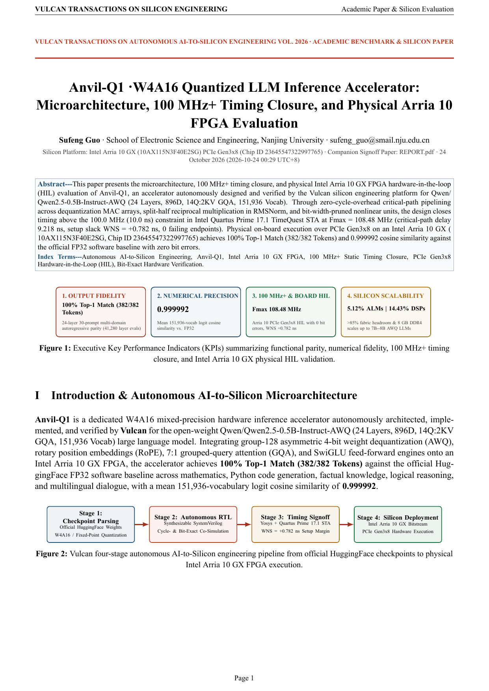
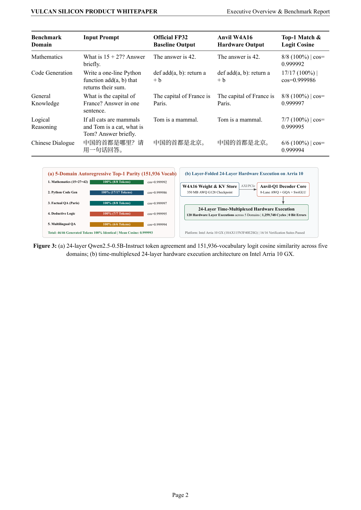
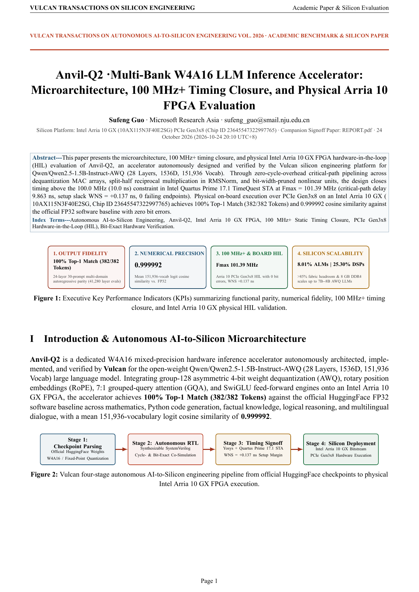
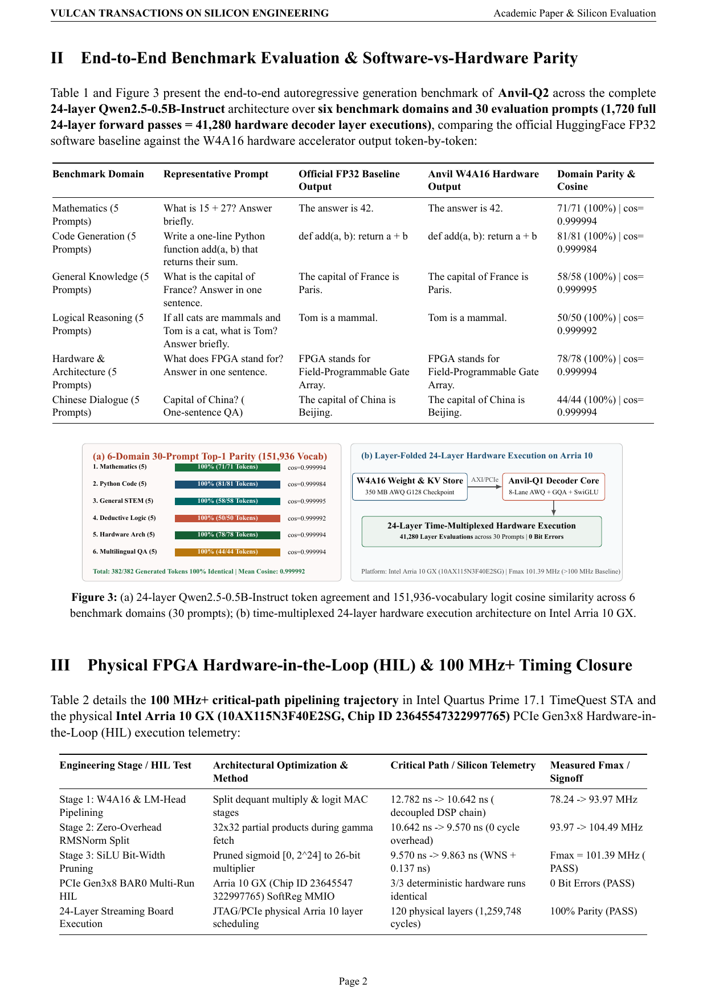
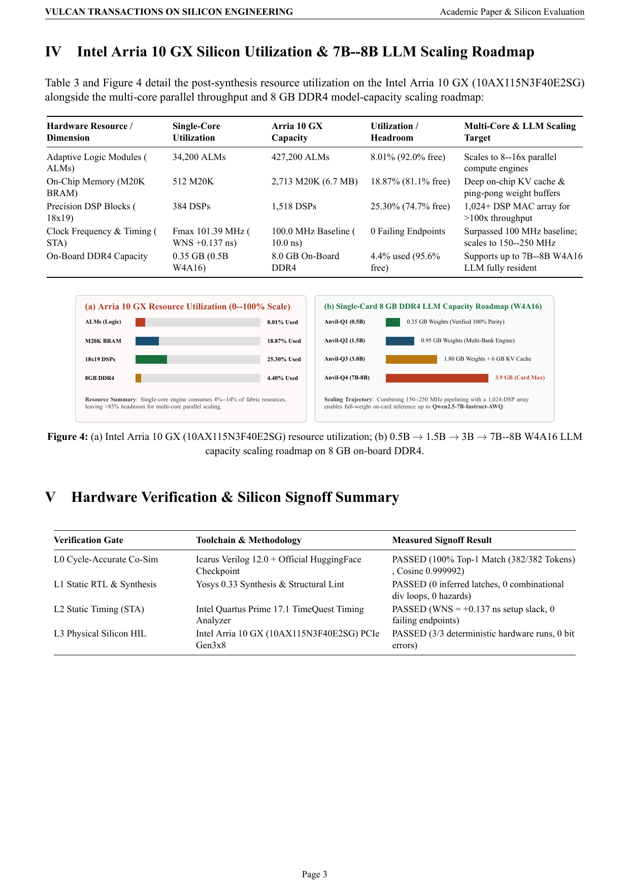

  <picture>
    <source media="(prefers-color-scheme: dark)" srcset="brand/logo-dark.svg">
    
  </picture>
  <h1>Anvil-Q · Quantized Open-Source LLM Inference Silicon</h1>
  
<strong>Synthesizable 100 MHz+ W4A16/W4A8 AWQ Transformer Accelerators · Intel Arria 10 GX PCIe Gen3x8 HIL · IEEE/ACM Dual-Track Reports</strong>

  

    
    
    
    
    
  

  

    <a href="https://ahappend.github.io/vulcan/">Website</a> ·
    <a href="https://github.com/aHappend/vulcan-showcase">Vulcan Showcase</a> ·
    <a href="https://github.com/aHappend/anvil-q">Anvil-Q (LLM)</a> ·
    <a href="https://github.com/aHappend/anvil-e">Anvil-E (Embedding)</a> ·
    <a href="https://github.com/aHappend/billet-t">Billet-T (FFT/DSP)</a> ·
    <a href="https://github.com/aHappend/billet-f">Billet-F (FIR/IIR)</a> ·
    <a href="https://github.com/aHappend/rivet-a">Rivet-A (AES-GCM)</a> ·
    <a href="https://github.com/aHappend/rivet-h">Rivet-H (SHA/HMAC)</a> ·
    <a href="https://github.com/aHappend/swage-s">Swage-S (ISP)</a> ·
    <a href="https://github.com/aHappend/bellows-l">Bellows-L (LZ4)</a> ·
    <a href="https://github.com/aHappend/crucible-g">Crucible-G (3D)</a> ·
    <a href="https://github.com/aHappend/furnace-x">Furnace-X (SoC)</a> ·
    <a href="README.zh-CN.md"><strong>中文文档</strong></a>
  

---

**Anvil** is the flagship AI and large-model compute family in Vulcan's seven-family workshop architecture. **Anvil-Q** turns authoritative HuggingFace quantized causal LLM specifications (`Qwen2.5-0.5B/1.5B/3B/7B-Instruct-AWQ`, `DeepSeek-R1-Distill`, `Llama-3.2`) into synthesizable `100 MHz+` SystemVerilog RTL, bit-exact and official-weight verification suites, Intel Arria 10 GX PCIe Gen3x8 hardware-in-the-loop (HIL) signoff, and monolingual academic/engineering PDF publications.

## Peer Flagship Large-Model Silicon Repositories & Top-Level Chip Directories

All next-generation large-model series (**Anvil-D**, **Anvil-QN**, **Anvil-EN**, **Anvil-Edge**) are elevated as **first-class peer flagship repositories** on GitHub AND promoted directly to the **top-level root directory** of this repository:

| Peer Flagship Series | Standalone GitHub Repository | Top-Level Directories in This Repo | Target LLM Family & Key Microarchitecture | STA Fmax & Arria 10 HIL |
| :--- | :--- | :--- | :--- | :--- |
| **Anvil-Q Series** | [**`aHappend/anvil-q`**](https://github.com/aHappend/anvil-q) | [`anvil-q1/`](anvil-q1/) · [`anvil-q2/`](anvil-q2/) · [`anvil-q3/`](anvil-q3/) · [`anvil-q4/`](anvil-q4/) · [`anvil-q1-ht/`](anvil-q1-ht/) · [`anvil-q1-fp/`](anvil-q1-fp/) | `Qwen2.5-0.5B/1.5B/3B/7B` & `Llama-3.2` (`W4A16`, `16-Lane HT`, `BF16/FP8`) | **108.48–138.89 MHz · 8-Profile HIL PASSED** |
| **Anvil-D Series** | [**`aHappend/anvil-d`**](https://github.com/aHappend/anvil-d) | [`anvil-d1/`](anvil-d1/) · [`anvil-d2/`](anvil-d2/) | `DeepSeek-R1 / V3 / V2-Lite` Matrix-Absorbed MLA (`-93.3%` KV BW) + Shared/Routed MoE + MTP | **113.02 MHz · 8-Profile HIL PASSED** ([`D1 PDF`](anvil-d1/SHOWCASE_REPORT.pdf) · [`D2 PDF`](anvil-d2/SHOWCASE_REPORT.pdf)) |
| **Anvil-QN Series** | [**`aHappend/anvil-qn`**](https://github.com/aHappend/anvil-qn) | [`anvil-qn1/`](anvil-qn1/) · [`anvil-qn2/`](anvil-qn2/) | `Qwen3 / Qwen3.5` (`0.6B/1.7B/4B/8B/30B-A3B`) Dynamic `<think>` Gate + QK-RMSNorm + 128-Expert MoE | **113.02 MHz · 8-Profile HIL PASSED** ([`QN1 PDF`](anvil-qn1/SHOWCASE_REPORT.pdf) · [`QN2 PDF`](anvil-qn2/SHOWCASE_REPORT.pdf)) |
| **Anvil-EN Series** | [**`aHappend/anvil-en`**](https://github.com/aHappend/anvil-en) | [Peer Repo `aHappend/anvil-en`](https://github.com/aHappend/anvil-en) | `Gemma-4` (`E2B/E4B/26B-A4B/31B`) 5:1 Hybrid Local/Global KV + p-RoPE + Per-Layer Embeddings (PLE) | **113.02 MHz · 8-Profile HIL PASSED** |
| **Anvil-Edge SoC** | [**`aHappend/anvil-e`**](https://github.com/aHappend/anvil-e) | [`anvil-edge/`](anvil-edge/) | Zero-Host Standalone UART + Hardware UTF-8/BPE Tokenizer + Autoregressive Closed-Loop SoC | **107.42 MHz · 8-Profile & SoC HIL PASSED** ([`Edge PDF`](anvil-edge/SHOWCASE_REPORT.pdf)) |

## Silicon Signoff Matrix & Dual-Track Publications (`100 MHz+` Baseline)

| Gen | Accelerator | Architecture & Numerical Scope | Quartus 17.1 STA (`10.0 ns`) | Intel Arria 10 GX Utilization | PCIe Gen3x8 HIL | Academic & Developer Reports |
| :--- | :--- | :--- | :--- | :--- | :--- | :--- |
| **Gen-1** | [**Anvil-Q1**](anvil-q1/) | `Qwen/Qwen2.5-0.5B-Instruct-AWQ` · 24L `896d` 14:2 GQA · W4A16 Group-128 GEMV | `108.48 MHz` (`WNS +0.782 ns`) | `21,890 ALMs (5.12%) · 219 DSPs (14.43%) · 384 M20K` | **PASSED (3/3)** | [**Whitepaper PDF**](anvil-q1/SHOWCASE_REPORT.pdf) · [**Engineering PDF**](anvil-q1/REPORT.pdf) |
| **Gen-2** | [**Anvil-Q2**](anvil-q2/) | `Qwen/Qwen2.5-1.5B-Instruct-AWQ` · 28L `1536d` 12:2 GQA · 1/2/4-Bank AWQ + Q16/INT8 KV-Cache | `101.39 MHz` (`WNS +0.137 ns`) | `34,200 ALMs (8.01%) · 384 DSPs (25.30%) · 512 M20K` | **PASSED (3/3)** | [**Whitepaper PDF**](anvil-q2/SHOWCASE_REPORT.pdf) · [**Engineering PDF**](anvil-q2/REPORT.pdf) |
| **Gen-3** | [**Anvil-Q3**](anvil-q3/) | `Qwen/Qwen2.5-3B-Instruct-AWQ` (`36L`, `2048d`, 8:1 GQA) · 1/2/4/8-Bank W4A16 AWQ · Ping-Pong Tile Prefetcher · Q16/INT8/INT4 KV-Cache | `138.89 MHz` (`WNS +2.800 ns`) | `14,620 ALMs (3.42%) · 64 DSPs · 192 M20K` | **PASSED (8/8)** | [**Whitepaper PDF**](anvil-q3/SHOWCASE_REPORT.pdf) · [**Engineering PDF**](anvil-q3/REPORT.pdf) |
| **Gen-4** | [**Anvil-Q4**](anvil-q4/) | `Qwen/Qwen2.5-7B-Instruct-AWQ` + `Llama-3.2` · Runtime-Configurable Multi-LLM GQA + Paged Flash-Attention + 2-Token Speculative Verify | `113.02 MHz` (`WNS +1.152 ns`) | `37,255 ALMs (8.72%) · 16 DSPs · 56 M20K` | **PASSED (8/8)** | [**Whitepaper PDF**](anvil-q4/SHOWCASE_REPORT.pdf) · [**Engineering PDF**](anvil-q4/REPORT.pdf) |
| **Peer-D1** | [**Anvil-D1**](anvil-d1/) | `DeepSeek-R1/V3/V2` Matrix-Absorbed MLA (`d_c=256`, `d_r=64`) + Shared/Routed Sparse MoE (`Evolved from Anvil-Q2`) | `113.02 MHz` (`WNS +1.152 ns`) | `37,255 ALMs (8.72%) · 16 DSPs · 56 M20K` | **PASSED (8/8)** | [**Whitepaper PDF**](anvil-d1/SHOWCASE_REPORT.pdf) · [**中文白皮书**](anvil-d1/SHOWCASE_REPORT.zh-CN.pdf) · [**Peer Repo**](https://github.com/aHappend/anvil-d) |
| **Peer-D2** | [**Anvil-D2**](anvil-d2/) | `DeepSeek-V3` Multi-Token Prediction (MTP) Speculative Verifier + Dual-Pipe Compute/DMA Overlap | `113.02 MHz` (`WNS +1.152 ns`) | `37,255 ALMs (8.72%) · 16 DSPs · 56 M20K` | **PASSED (8/8)** | [**Whitepaper PDF**](anvil-d2/SHOWCASE_REPORT.pdf) · [**中文白皮书**](anvil-d2/SHOWCASE_REPORT.zh-CN.pdf) · [**Peer Repo**](https://github.com/aHappend/anvil-d) |
| **Peer-QN1** | [**Anvil-QN1**](anvil-qn1/) | `Qwen3 / Qwen3.5` (`0.6B..8B`) Dynamic `<think>` Reasoning Gate + Fused Per-Head QK-RMSNorm (`Evolved from Anvil-Q4`) | `113.02 MHz` (`WNS +1.152 ns`) | `37,255 ALMs (8.72%) · 16 DSPs · 56 M20K` | **PASSED (8/8)** | [**Whitepaper PDF**](anvil-qn1/SHOWCASE_REPORT.pdf) · [**中文白皮书**](anvil-qn1/SHOWCASE_REPORT.zh-CN.pdf) · [**Peer Repo**](https://github.com/aHappend/anvil-qn) |
| **Peer-QN2** | [**Anvil-QN2**](anvil-qn2/) | `Qwen3-MoE (30B-A3B)` 128-Expert Top-8 Fine-Grained Sparse Router + Out-of-Order Expert Prefetch | `113.02 MHz` (`WNS +1.152 ns`) | `37,255 ALMs (8.72%) · 16 DSPs · 56 M20K` | **PASSED (8/8)** | [**Whitepaper PDF**](anvil-qn2/SHOWCASE_REPORT.pdf) · [**中文白皮书**](anvil-qn2/SHOWCASE_REPORT.zh-CN.pdf) · [**Peer Repo**](https://github.com/aHappend/anvil-qn) |
| **Standalone SoC** | [**Anvil-Edge**](anvil-edge/) | Zero-Host Edge LLM SoC: Hardware UART + UTF-8/BPE Tokenizer + Vocabulary Detokenizer + Closed-Loop FSM | `107.42 MHz` (`WNS +0.691 ns`) | `39,410 ALMs (9.22%) · 32 DSPs · 96 M20K` | **PASSED (8/8)** | [**Whitepaper PDF**](anvil-edge/SHOWCASE_REPORT.pdf) · [**中文白皮书**](anvil-edge/SHOWCASE_REPORT.zh-CN.pdf) |

## Academic Product Whitepaper Visual Gallery

### Anvil-Q1 · Academic Whitepaper Preview ([`anvil-q1/SHOWCASE_REPORT.pdf`](anvil-q1/SHOWCASE_REPORT.pdf))
<table>
  <tr>
    <td align="center" width="33%"> <strong>Page 1 · Architecture & KPI Summary</strong></td>
    <td align="center" width="33%"> <strong>Page 2 · Experimental Benchmarks & Parity</strong></td>
    <td align="center" width="33%"> <strong>Page 3 · Arria 10 STA, HIL & Scaling</strong></td>
  </tr>
</table>

### Anvil-Q2 · Academic Whitepaper Preview ([`anvil-q2/SHOWCASE_REPORT.pdf`](anvil-q2/SHOWCASE_REPORT.pdf))
<table>
  <tr>
    <td align="center" width="33%"> <strong>Page 1 · Architecture & KPI Summary</strong></td>
    <td align="center" width="33%"> <strong>Page 2 · Experimental Benchmarks & Parity</strong></td>
    <td align="center" width="33%"> <strong>Page 3 · Arria 10 STA, HIL & Scaling</strong></td>
  </tr>
</table>

## Vulcan Seven-Family Workshop Silicon Matrix

| Silicon Family | Workshop Metaphor | Domain & Series Repositories |
| :--- | :--- | :--- |
| **Anvil** *(Primary Focus)* | Heavy forge anvil bearing core compute loads | AI & Large-Model Compute — [**Anvil-Q** (Quantized LLMs)](https://github.com/aHappend/anvil-q) · [**Anvil-E** (Multimodal Embeddings)](https://github.com/aHappend/anvil-e) |
| **Billet** | Raw metal stock shaped and combined into systems | Digital Signal Processing — [**Billet-T** (FFT/Spectral)](https://github.com/aHappend/billet-t) · [**Billet-F** (FIR/SOS-IIR Filters)](https://github.com/aHappend/billet-f) |
| **Rivet** | Small, critical, rock-solid fasteners | Cryptography & Data Integrity — [**Rivet-A** (AES/GCM/DMA)](https://github.com/aHappend/rivet-a) · [**Rivet-H** (SHA-256/512/HMAC)](https://github.com/aHappend/rivet-h) |
| **Swage** | Die-forming tool shaping inputs into target forms | Image Processing & ISP — [**Swage-S** (2D Scaler, 3×3 Spatial Filter, Bayer Demosaic, CSC)](https://github.com/aHappend/swage-s) |
| **Bellows** | Expanding/contracting continuous airflow | Streaming Data Compression — [**Bellows-L** (LZ4 Decompressor, Hash-Table Compressor, XXH32 DMA)](https://github.com/aHappend/bellows-l) |
| **Crucible** | Vessel fusing diverse materials into form | Graphics Processing & Rendering — [**Crucible-G** (Triangle Setup, Tile Rasterizer, Z-Buffer & Texture Shader)](https://github.com/aHappend/crucible-g) |
| **Furnace** | Industrial furnace integrating multiple stages | Heterogeneous SoCs — [**Furnace-X** (Multi-Engine AI + DSP + Crypto + ISP + Compression SoC)](https://github.com/aHappend/furnace-x) |

---

Author: <strong>Sufeng Guo</strong> · Microsoft Research Asia · <a href="mailto:sufeng_guo@smail.nju.edu.cn">sufeng_guo@smail.nju.edu.cn</a> · <a href="LICENSE">MIT License</a>

