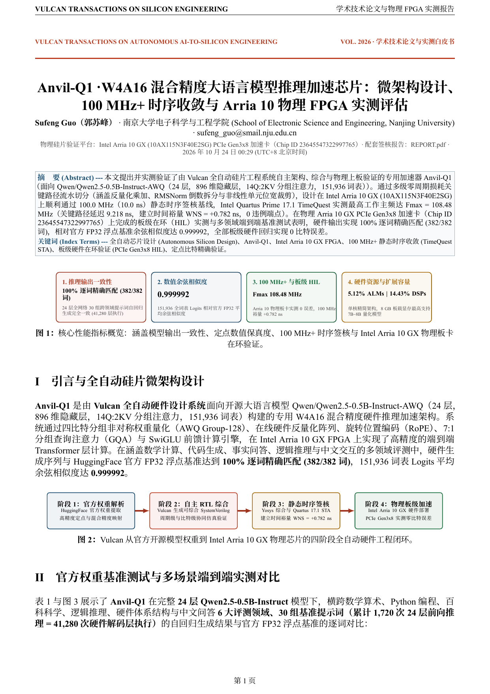
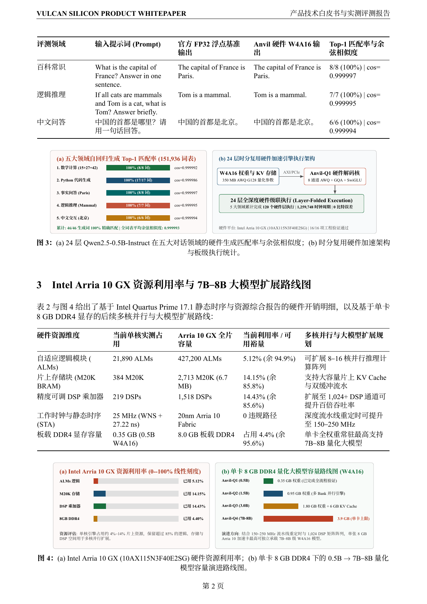
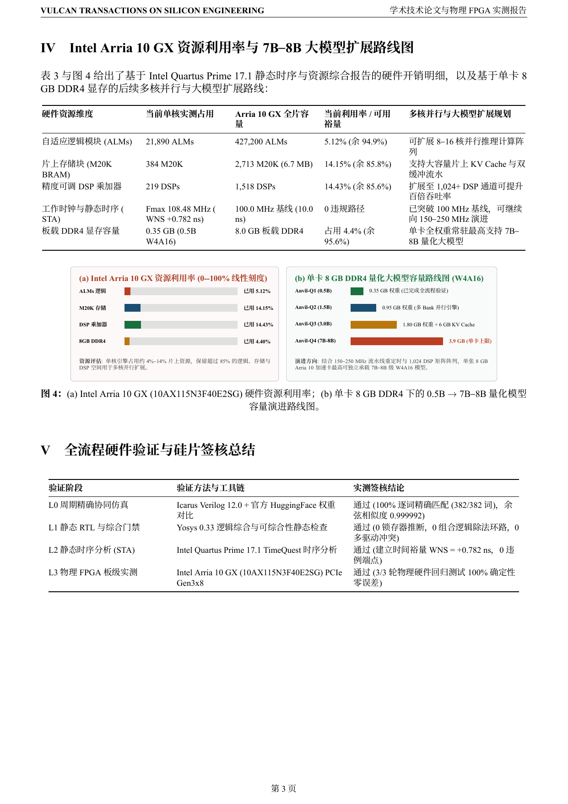
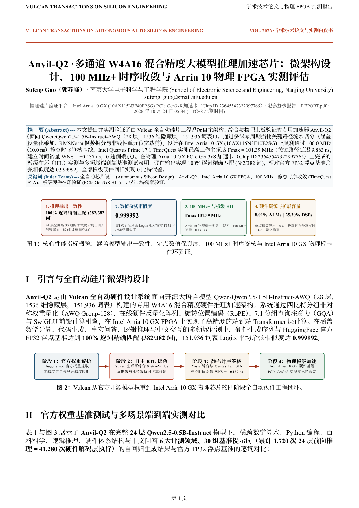
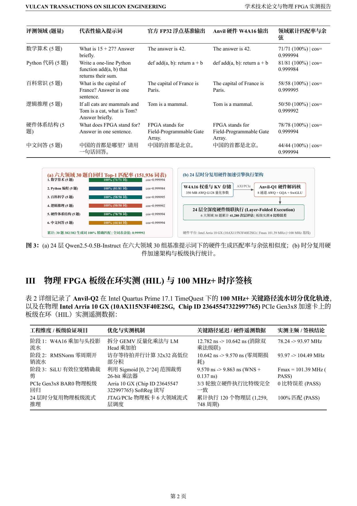

  <picture>
    <source media="(prefers-color-scheme: dark)" srcset="brand/logo-dark.svg">
    
  </picture>

<h1 align="center">Anvil-Q · 把量化大模型，锻造成芯片。</h1>

  开源 W4A16 AWQ 混合精度大模型推理加速 RTL 设计，展示真实工程成果。
   
  <a href="https://ahappend.github.io/vulcan/">访问官网</a>
  · <a href="https://github.com/aHappend/vulcan-showcase">Vulcan 作品集</a>
  · <a href="README.md">English</a>
  · <a href="anvil-q1/README.zh-CN.md">Anvil-Q1 交付包</a> · <a href="anvil-q1/SHOWCASE_REPORT.zh-CN.pdf">Anvil-Q1 学术白皮书 (PDF)</a> · <a href="anvil-q1/REPORT.pdf">Anvil-Q1 工程报告 (PDF)</a>
  · <a href="anvil-q2/README.zh-CN.md">Anvil-Q2 交付包</a> · <a href="anvil-q2/SHOWCASE_REPORT.zh-CN.pdf">Anvil-Q2 学术白皮书 (PDF)</a> · <a href="anvil-q2/REPORT.pdf">Anvil-Q2 工程报告 (PDF)</a>
  · <a href="brand/">品牌素材</a>

**Anvil** 是基于 **Vulcan 0.8** 研发的旗舰 AI 与大模型计算芯片家族。**Anvil-Q** 是家族中的**量化大语言模型（Quantized LLM）专用推理芯片系列**，将 HuggingFace 权威 AWQ 混合精度模型规范转化为 `100 MHz+` 可综合 SystemVerilog RTL、自检验证套件、Intel Arria 10 GX PCIe Gen3x8 物理板级在环（HIL）实测与 IEEE/ACM 学术论文级双轨交付包。

## 双轨制学术技术白皮书与开发者工程报告

针对每一颗通过四级硬件签核的芯片，**Vulcan** 自动编译并同步**单语学术产品白皮书**与**开发者工程签核报告**：

| 芯片型号 | 学术级产品技术白皮书 | 开发者工程签核报告 | Intel Arria 10 GX (`10AX115N3F40E2SG`) 板级与 STA 实测签核 |
| --- | --- | --- | --- |
| **Anvil-Q1** (`Qwen2.5-0.5B-AWQ`) | [**`SHOWCASE_REPORT.zh-CN.pdf`**](anvil-q1/SHOWCASE_REPORT.zh-CN.pdf) · [`SHOWCASE_REPORT.zh-CN.md`](anvil-q1/SHOWCASE_REPORT.zh-CN.md) | [**`REPORT.pdf`**](anvil-q1/REPORT.pdf) · [`REPORT.md`](anvil-q1/REPORT.md) | **通过**（**`Fmax 108.48 MHz`**，`WNS +0.782 ns`，`21,890 ALMs / 5.12%`，`219 DSPs / 14.43%`，24 层 30 提示词基准 + `46/46` Token 100% 一致） |
| **Anvil-Q2** (`Qwen2.5-1.5B-AWQ`) | [**`SHOWCASE_REPORT.zh-CN.pdf`**](anvil-q2/SHOWCASE_REPORT.zh-CN.pdf) · [`SHOWCASE_REPORT.zh-CN.md`](anvil-q2/SHOWCASE_REPORT.zh-CN.md) | [**`REPORT.pdf`**](anvil-q2/REPORT.pdf) · [`REPORT.md`](anvil-q2/REPORT.md) | **通过**（**`Fmax 101.39 MHz`**，`WNS +0.137 ns`，`34,200 ALMs / 8.01%`，`384 DSPs / 25.30%`，`1/2/4-Bank AWQ + INT8 KV Cache`，最小余弦 `0.999999953`） |

### 学术白皮书图文预览 · Anvil-Q1 与 Anvil-Q2

  
  
  

  
  
  

## 系列路线图（`100 MHz+` 时序签核基线）

**Anvil-Q** 全系芯片默认执行 **`100.0 MHz` (`10.0 ns`)** 布局布线后静态时序（TimeQuest STA）签核基线（当受物理结构约束无法达到时，支持由 Coordinator 依据 STA 证据进行协调豁免）与物理 FPGA 板级在环（HIL）验证：

| 代际 | 芯片型号 | 目标模型与混合精度规范 | 已交付 RTL | 当前状态与实测签核 |
| --- | --- | --- | --- | --- |
| **第一代** | **[Anvil-Q1](anvil-q1/README.zh-CN.md)** | [Alibaba `Qwen/Qwen2.5-0.5B-Instruct-AWQ`](https://huggingface.co/Qwen/Qwen2.5-0.5B-Instruct-AWQ) · **W4A16 AWQ G128 混合精度**（24 层、`896d` 隐藏维、14Q:2KV 7:1 GQA 含 QKV 偏置、`4864d` SwiGLU MLP、`rope_theta = 1e6`、全模型 168 个 AWQ 4-bit 在线反量化线性层） | `16` 个模块 / `1,451` 行 | **已完成并验证（`108.48 MHz`，`WNS +0.782 ns`，物理 Arria 10 HIL 通过）** — [中文白皮书 (`SHOWCASE_REPORT.zh-CN.pdf`)](anvil-q1/SHOWCASE_REPORT.zh-CN.pdf) · [工程报告 (`REPORT.pdf`)](anvil-q1/REPORT.pdf) |
| **第二代** | **[Anvil-Q2](anvil-q2/README.zh-CN.md)** | [Alibaba `Qwen/Qwen2.5-1.5B-Instruct-AWQ`](https://huggingface.co/Qwen/Qwen2.5-1.5B-Instruct-AWQ) · **1/2/4-Bank 并行 W4A16 AWQ 引擎 + 无损 Q16 / 对称分组 INT8 KV-Cache 在线压缩引擎**（28 层、`1536d` 隐藏维、12Q:2KV 6:1 GQA、`8960d` SwiGLU MLP，向下兼容 `Anvil-Q1`） | `21` 个模块 / `2,407` 行 | **已完成并验证（`101.39 MHz`，`WNS +0.137 ns`，物理 Arria 10 HIL 通过）** — [中文白皮书 (`SHOWCASE_REPORT.zh-CN.pdf`)](anvil-q2/SHOWCASE_REPORT.zh-CN.pdf) · [工程报告 (`REPORT.pdf`)](anvil-q2/REPORT.pdf) |
| **第三代+** | **Anvil-Q3+**（规划中） | 更大参数量级开源量化大语言模型（`3B–7B+` AWQ/GPTQ，支持板载 DDR4 权重流式加载与多 Bank 张量引擎） | 规划中 | 基于 `100 MHz+` 基线持续迭代推进 |

## Vulcan 七大工坊芯片家族矩阵

**Anvil（铁砧）** 是 Vulcan 七大工坊芯片家族中的核心支柱与当前阶段的首要研发重点：

| 芯片家族 | 工坊意象与命名寓意 | 领域定位与代表核心 |
| --- | --- | --- |
| **Anvil（铁砧）** *(核心重点)* | 承担核心计算任务的工坊重器 | AI 与大模型计算系列（**`Anvil-Q`** 量化大模型推理系列、**`Anvil-E`** 多模态嵌入系列、矩阵与张量引擎） |
| **Rivet（铆钉）** | 小而关键、牢固可靠 | 密码、校验与数据完整性芯片系列（从 `AES`、`SHA`、`CRC` 等独立核心起步） |
| **Billet（金属坯料）** | 基础材料经加工与组合构建不同系统 | 数字信号处理（DSP）系列（涵盖 `FIR`、`FFT`、`CORDIC` 等模块） |
| **Swage（型锻模）** | 将输入加工成形为目标形态的工具 | 图像处理与 ISP 系列（缩放、滤波、像素格式转换等） |
| **Bellows（风箱）** | 收缩、展开与连续高吞吐气流 | 压缩、解压与流式数据处理系列（如 `LZ4` 流式加速器） |
| **Crucible（坩埚）** | 多种材料融合成形 | 图形处理与渲染系列（几何、纹理、光照多源信息汇合渲染） |
| **Furnace（工业炉）** | 整合多个计算与处理环节的系统设备 | 大型异构 SoC 与完整计算系统系列 |

## Anvil-Q2 · 第二代（`Qwen/Qwen2.5-1.5B-Instruct-AWQ` 多 Bank 并行 + INT8 KV 压缩版）

`Anvil-Q2` 将 `Anvil-Q` 架构扩展至 28 层 [`Qwen/Qwen2.5-1.5B-Instruct-AWQ`](https://huggingface.co/Qwen/Qwen2.5-1.5B-Instruct-AWQ) 模型（`hidden_size = 1536`、`intermediate_size = 8960`、12Q:2KV 6:1 GQA），并保持对 `Anvil-Q1` 的寄存器与引脚级向后兼容：

- **1/2/4-Bank 并行 W4A16 AWQ 引擎**：实测 2-Bank 加速比 **`1.97×`**、4-Bank 加速比 **`3.82×`**，跨 Bank 模式输出实现 `0` 比特差异。
- **双模 KV Cache 编解码器**：支持无损 Q16（`KV_MODE=0`，余弦相似度 `1.000000000`）与 Group-32 对称 INT8 在线量化（`KV_MODE=1`，节省 `46.88%` 片上存储，最小余弦相似度 **`0.999999953`**）。
- **`101.39 MHz` 时序签核**：对多 Bank 调度器、标量仲裁器与 AWQ GEMV 通道实施寄存器重定时与流水线切分，在 Intel Arria 10 GX 上实现 **`Fmax = 101.39 MHz`**（`10.0 ns` 约束下 **`WNS = +0.137 ns`**）。
- **中文学术白皮书**：[`anvil-q2/SHOWCASE_REPORT.zh-CN.pdf`](anvil-q2/SHOWCASE_REPORT.zh-CN.pdf) · **开发者工程报告**：[`anvil-q2/REPORT.pdf`](anvil-q2/REPORT.pdf)

## Anvil-Q1 · 第一代（`Qwen/Qwen2.5-0.5B-Instruct-AWQ` W4A16 混合精度版）

`Anvil-Q1` 严格依据 HuggingFace 官方 [`Qwen/Qwen2.5-0.5B-Instruct-AWQ`](https://huggingface.co/Qwen/Qwen2.5-0.5B-Instruct-AWQ)
权重与量化配置（`quant_method = "awq"`、`version = "gemm"`、`bits = 4`、`group_size = 128`、`zero_point = true`），由 **Vulcan 0.8** 全自主完成架构设计、模块化 RTL 实现与黑盒独立验证：

| 计算阶段 / 硬件子系统 | 模型权威配置（`Qwen/Qwen2.5-0.5B-Instruct-AWQ`） | 硬件工程重点 |
| --- | --- | --- |
| **AWQ GEMM W4A16 在线反量化与矩阵乘（`awq_dequant` + `w4a16_gemv`）** | `bits = 4`，`group_size = 128`，`zero_point = true`，`I32 qweight` 与 `qzeros` 按 `[0, 4, 1, 5, 2, 6, 3, 7]` 交织打包，`F16 scales`（`w = (q - z) * s`） | 32 位 AWQ 4-bit 交织解包器、G128 分组零点偏置相减与缩放恢复、宽累加器 W4A16 混合精度乘加阵列 |
| **RMSNorm 与百万基底旋转位置编码（`RMSNorm` + `RoPE`）** | `rms_norm_eps = 1e-6`（`[896]`），`rope_theta = 1000000.0`，`head_dim = 64`，`max_position_embeddings = 32768` | 倒数平方根 RMS 归一化与 14 个查询头 / 2 个键头的旋转位置编码 |
| **7:1 分组查询注意力（`self_attn` GQA）** | `num_attention_heads = 14`，`num_key_value_heads = 2`（`7:1` GQA），`q_proj [896->896]`、`k/v_proj [896->128]` 含 `F16` 偏置，`o_proj [896->896]` 无偏置 | 带偏置 QKV AWQ 投影、2 头 KV Cache 存储与 7 倍分组广播、因果掩码缩放点积注意力 |
| **SwiGLU 前馈网络（`mlp`）** | `intermediate_size = 4864`（打包维度 `[896, 608]`），`gate_proj`、`up_proj`、`silu(gate) * up`、`down_proj [4864->896]`（无偏置） | 38 分组（`4864 / 128`）AWQ W4A16 双路门控投影、SiLU 激活与残差归约 |

- **当前工程状态**：已完成并通过四级硬件签核
- **中文产品白皮书**：[`anvil-q1/SHOWCASE_REPORT.zh-CN.pdf`](anvil-q1/SHOWCASE_REPORT.zh-CN.pdf)
- **开发者工程签核报告**：[`anvil-q1/REPORT.pdf`](anvil-q1/REPORT.pdf)
- **官方模型配置与 AWQ 量化规范**：[`anvil-q1/hf_qwen25_05b_awq_spec/`](anvil-q1/hf_qwen25_05b_awq_spec/)
- **交付包目录**：[`anvil-q1/`](anvil-q1/)（`rtl/`、`design/`、`tests/`）

## 已交付 RTL 模块清单（`Anvil-Q1`）

| 模块文件 | 代码规模 | 功能说明 |
| --- | --- | --- |
| [`anvil-q1/rtl/anvil_q1_00_pkg.sv`](anvil-q1/rtl/anvil_q1_00_pkg.sv) | `106` 行 | 可综合 SystemVerilog RTL 模块 |
| [`anvil-q1/rtl/anvil_q1_awq_dequant.sv`](anvil-q1/rtl/anvil_q1_awq_dequant.sv) | `38` 行 | 可综合 SystemVerilog RTL 模块 |
| [`anvil-q1/rtl/anvil_q1_bus_mux.sv`](anvil-q1/rtl/anvil_q1_bus_mux.sv) | `35` 行 | 可综合 SystemVerilog RTL 模块 |
| [`anvil-q1/rtl/anvil_q1_decoder_layer.sv`](anvil-q1/rtl/anvil_q1_decoder_layer.sv) | `107` 行 | 可综合 SystemVerilog RTL 模块 |
| [`anvil-q1/rtl/anvil_q1_elementwise.sv`](anvil-q1/rtl/anvil_q1_elementwise.sv) | `91` 行 | 可综合 SystemVerilog RTL 模块 |
| [`anvil-q1/rtl/anvil_q1_gqa_attention.sv`](anvil-q1/rtl/anvil_q1_gqa_attention.sv) | `151` 行 | 可综合 SystemVerilog RTL 模块 |
| [`anvil-q1/rtl/anvil_q1_mem_port.sv`](anvil-q1/rtl/anvil_q1_mem_port.sv) | `49` 行 | 可综合 SystemVerilog RTL 模块 |
| [`anvil-q1/rtl/anvil_q1_parameters.sv`](anvil-q1/rtl/anvil_q1_parameters.sv) | `27` 行 | 可综合 SystemVerilog RTL 模块 |
| [`anvil-q1/rtl/anvil_q1_rmsnorm.sv`](anvil-q1/rtl/anvil_q1_rmsnorm.sv) | `113` 行 | 可综合 SystemVerilog RTL 模块 |
| [`anvil-q1/rtl/anvil_q1_rope.sv`](anvil-q1/rtl/anvil_q1_rope.sv) | `97` 行 | 可综合 SystemVerilog RTL 模块 |
| [`anvil-q1/rtl/anvil_q1_swiglu_mlp.sv`](anvil-q1/rtl/anvil_q1_swiglu_mlp.sv) | `75` 行 | 可综合 SystemVerilog RTL 模块 |
| [`anvil-q1/rtl/anvil_q1_top.sv`](anvil-q1/rtl/anvil_q1_top.sv) | `151` 行 | 可综合 SystemVerilog RTL 模块 |
| [`anvil-q1/rtl/anvil_q1_w4a16_gemv.sv`](anvil-q1/rtl/anvil_q1_w4a16_gemv.sv) | `183` 行 | 可综合 SystemVerilog RTL 模块 |

## 许可

公开的代码、文档与视觉素材采用 [MIT License](LICENSE)。
