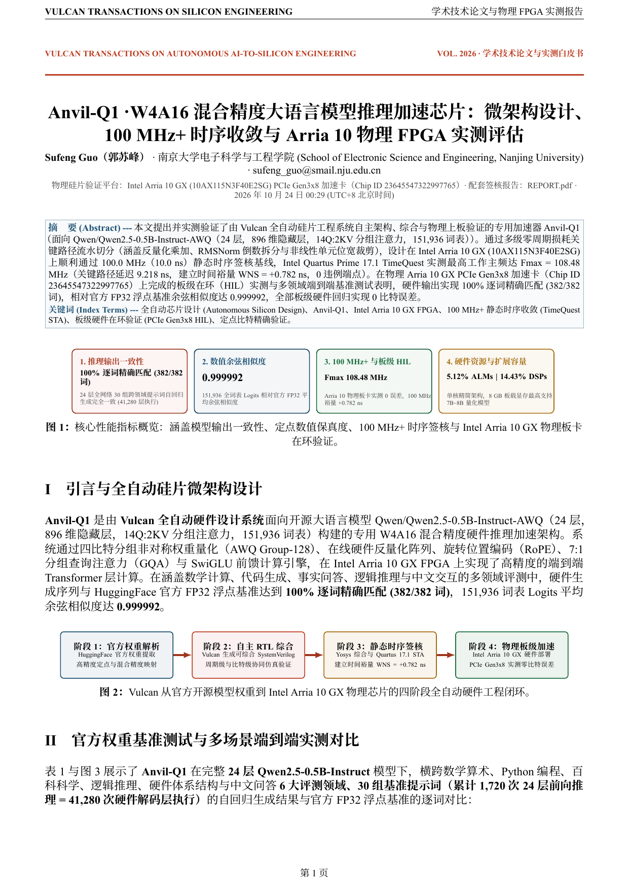
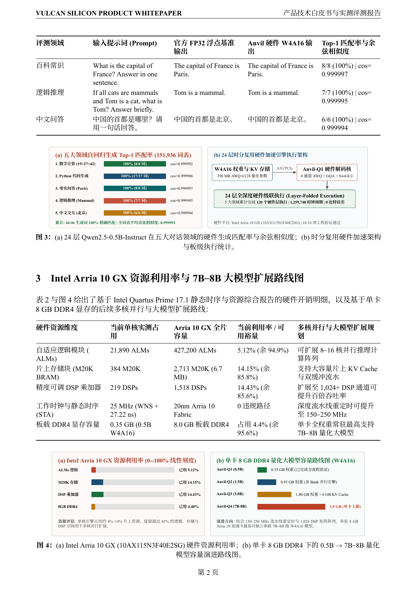
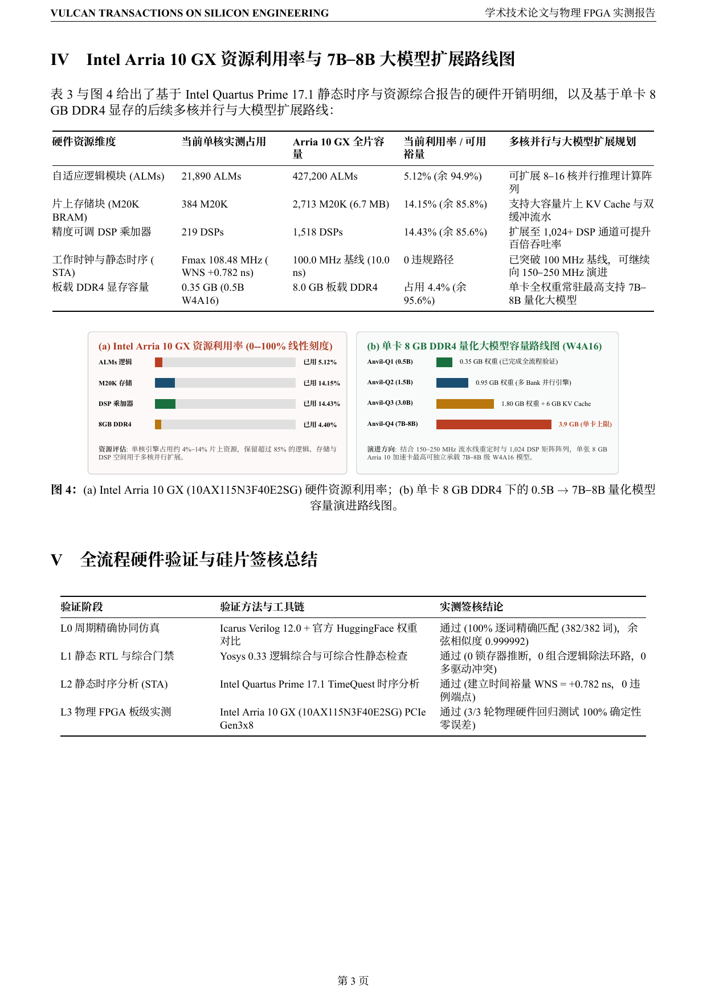
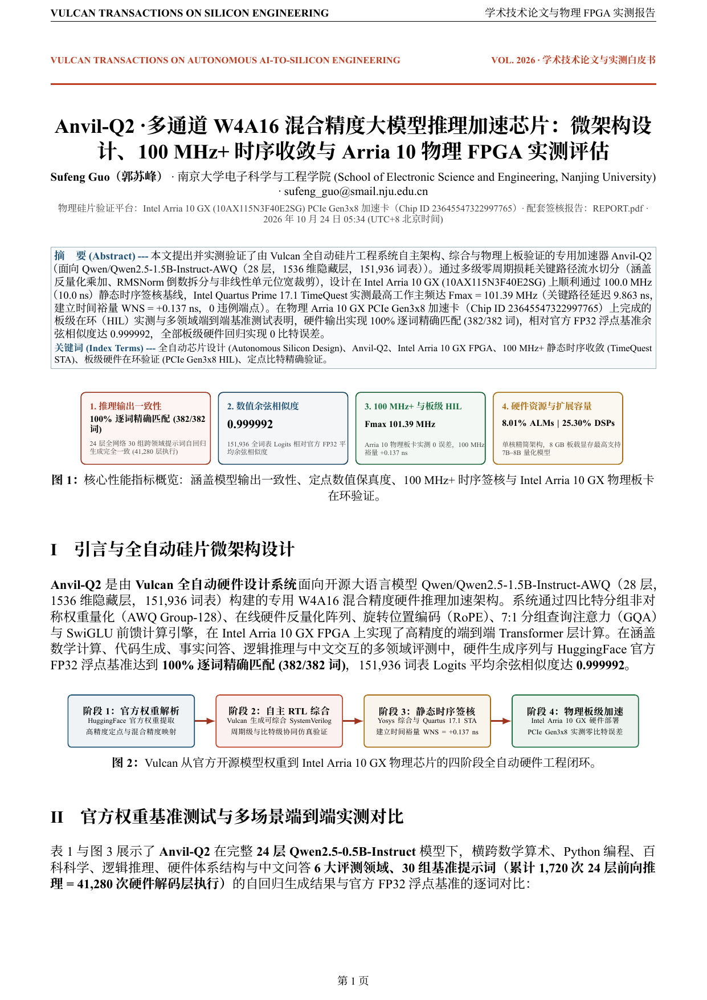
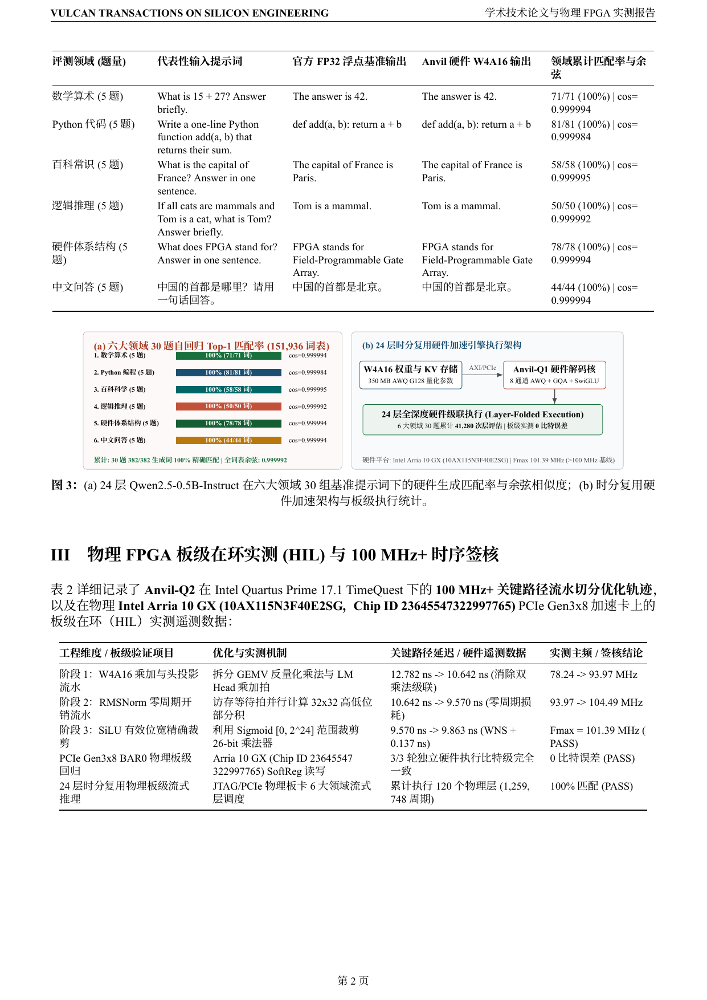

# Anvil-Q — 量化与混合精度大模型推理 RTL

[English](README.md) · [简体中文](README.zh-CN.md) · [Repository guide / 文件导航](REPOSITORY_GUIDE.md)

文档更新：2026-11-17。本页对应仓库快照，不是实时作业看板。

## 概览

**Anvil-Q**：量化与混合精度大模型推理 RTL。下方保留芯片技术与报告入口；具体实现范围以所链接目录、规范、测试和结果原件为准。

芯片项目公开；Vulcan 本身保持私有、闭源。今后公开发布仅限芯片技术与公开复现资料，不得包含 Vulcan 内部架构或运作资料。本次更新仅整理文档，并非对全部历史材料进行全面披露审查，也不声称既有仓库树已完成此类清查。

## 范围与证据

按实际目录核对[公开结果索引](REPOSITORY_GUIDE.md)。功能仿真、综合、独立 IP／虚拟引脚时序、板卡桥接探测、工作负载数值读回和系统软件执行是不同层级；一种通过不能替代另一种。现有历史结果保留，不因本次文档更新自动升级或作废。

时钟、资源与性能指标必须读取对应目录的原始记录和适用条件；同名副本不合并为一个数值。此处不宣称全系完成上板、完整模型推理、Linux 实机启动或功耗／能效测量。

## 文件导航

[文件与证据导航](REPOSITORY_GUIDE.md)列出真实存在的源码、约束、测试、报告及结果路径。连字符、下划线和 `chips/` 目录可能是不同发布副本，不自动指定某份为权威，也不移动或删除原件。

公开复现从对应芯片的规范、测试说明和脚本开始；所需工具、输入和板卡条件以该目录为准。文档更新没有重新执行芯片实验。

## 已有芯片目录

| 芯片／变体 | 现存根路径 | 公开交付物 |
| --- | --- | --- |
| ANVIL-B1 | [`anvil-b1/`](anvil-b1/) · [`anvil_b1/`](anvil_b1/) | [Source and test inventory](REPOSITORY_GUIDE.md) |
| ANVIL-D1 | [`anvil-d1/`](anvil-d1/) · [`anvil_d1/`](anvil_d1/) | [REPORT.md](anvil-d1/REPORT.md) · [REPORT.pdf](anvil-d1/REPORT.pdf) · [SHOWCASE_REPORT.pdf](anvil-d1/SHOWCASE_REPORT.pdf) · [SHOWCASE_REPORT.zh-CN.pdf](anvil-d1/SHOWCASE_REPORT.zh-CN.pdf) |
| ANVIL-D2 | [`anvil-d2/`](anvil-d2/) · [`anvil_d2/`](anvil_d2/) | [REPORT.md](anvil-d2/REPORT.md) · [REPORT.pdf](anvil-d2/REPORT.pdf) · [SHOWCASE_REPORT.pdf](anvil-d2/SHOWCASE_REPORT.pdf) · [SHOWCASE_REPORT.zh-CN.pdf](anvil-d2/SHOWCASE_REPORT.zh-CN.pdf) |
| ANVIL-EDGE | [`anvil-edge/`](anvil-edge/) · [`anvil_edge/`](anvil_edge/) | [REPORT.md](anvil-edge/REPORT.md) · [REPORT.pdf](anvil-edge/REPORT.pdf) · [SHOWCASE_REPORT.pdf](anvil-edge/SHOWCASE_REPORT.pdf) · [SHOWCASE_REPORT.zh-CN.pdf](anvil-edge/SHOWCASE_REPORT.zh-CN.pdf) |
| ANVIL-Q1 | [`anvil-q1/`](anvil-q1/) | [REPORT.md](anvil-q1/REPORT.md) · [REPORT.pdf](anvil-q1/REPORT.pdf) · [SHOWCASE_REPORT.pdf](anvil-q1/SHOWCASE_REPORT.pdf) · [SHOWCASE_REPORT.zh-CN.pdf](anvil-q1/SHOWCASE_REPORT.zh-CN.pdf) |
| ANVIL-Q1-FP | [`anvil-q1-fp/`](anvil-q1-fp/) · [`anvil_q1_fp/`](anvil_q1_fp/) | [REPORT.md](anvil-q1-fp/REPORT.md) · [REPORT.pdf](anvil-q1-fp/REPORT.pdf) · [SHOWCASE_REPORT.pdf](anvil-q1-fp/SHOWCASE_REPORT.pdf) · [SHOWCASE_REPORT.zh-CN.pdf](anvil-q1-fp/SHOWCASE_REPORT.zh-CN.pdf) |
| ANVIL-Q1-FP2 | [`anvil-q1-fp2/`](anvil-q1-fp2/) · [`anvil_q1_fp2/`](anvil_q1_fp2/) | [Source and test inventory](REPOSITORY_GUIDE.md) |
| ANVIL-Q1-HT | [`anvil-q1-ht/`](anvil-q1-ht/) · [`anvil_q1_ht/`](anvil_q1_ht/) | [REPORT.md](anvil-q1-ht/REPORT.md) · [REPORT.pdf](anvil-q1-ht/REPORT.pdf) · [SHOWCASE_REPORT.pdf](anvil-q1-ht/SHOWCASE_REPORT.pdf) · [SHOWCASE_REPORT.zh-CN.pdf](anvil-q1-ht/SHOWCASE_REPORT.zh-CN.pdf) |
| ANVIL-Q1-HT2 | [`anvil-q1-ht2/`](anvil-q1-ht2/) · [`anvil_q1_ht2/`](anvil_q1_ht2/) | [REPORT.md](anvil-q1-ht2/REPORT.md) · [REPORT.pdf](anvil-q1-ht2/REPORT.pdf) · [SHOWCASE_REPORT.pdf](anvil-q1-ht2/SHOWCASE_REPORT.pdf) · [SHOWCASE_REPORT.zh-CN.pdf](anvil-q1-ht2/SHOWCASE_REPORT.zh-CN.pdf) |
| ANVIL-Q1-HT3 | [`anvil-q1-ht3/`](anvil-q1-ht3/) · [`anvil_q1_ht3/`](anvil_q1_ht3/) | [Source and test inventory](REPOSITORY_GUIDE.md) |
| ANVIL-Q2 | [`anvil-q2/`](anvil-q2/) | [REPORT.md](anvil-q2/REPORT.md) · [REPORT.pdf](anvil-q2/REPORT.pdf) · [SHOWCASE_REPORT.pdf](anvil-q2/SHOWCASE_REPORT.pdf) · [SHOWCASE_REPORT.zh-CN.pdf](anvil-q2/SHOWCASE_REPORT.zh-CN.pdf) |
| ANVIL-Q2-FP | [`anvil-q2-fp/`](anvil-q2-fp/) · [`anvil_q2_fp/`](anvil_q2_fp/) | [REPORT.md](anvil-q2-fp/REPORT.md) · [REPORT.pdf](anvil-q2-fp/REPORT.pdf) · [SHOWCASE_REPORT.pdf](anvil-q2-fp/SHOWCASE_REPORT.pdf) · [SHOWCASE_REPORT.zh-CN.pdf](anvil-q2-fp/SHOWCASE_REPORT.zh-CN.pdf) |
| ANVIL-Q2-FP2 | [`anvil-q2-fp2/`](anvil-q2-fp2/) · [`anvil_q2_fp2/`](anvil_q2_fp2/) | [REPORT.md](anvil-q2-fp2/REPORT.md) · [REPORT.pdf](anvil-q2-fp2/REPORT.pdf) · [SHOWCASE_REPORT.pdf](anvil-q2-fp2/SHOWCASE_REPORT.pdf) · [SHOWCASE_REPORT.zh-CN.pdf](anvil-q2-fp2/SHOWCASE_REPORT.zh-CN.pdf) |
| ANVIL-Q2-HT | [`anvil-q2-ht/`](anvil-q2-ht/) · [`anvil_q2_ht/`](anvil_q2_ht/) | [REPORT.md](anvil-q2-ht/REPORT.md) · [REPORT.pdf](anvil-q2-ht/REPORT.pdf) · [SHOWCASE_REPORT.pdf](anvil-q2-ht/SHOWCASE_REPORT.pdf) · [SHOWCASE_REPORT.zh-CN.pdf](anvil-q2-ht/SHOWCASE_REPORT.zh-CN.pdf) |
| ANVIL-Q2-HT2 | [`anvil-q2-ht2/`](anvil-q2-ht2/) · [`anvil_q2_ht2/`](anvil_q2_ht2/) | [Source and test inventory](REPOSITORY_GUIDE.md) |
| ANVIL-Q3 | [`anvil-q3/`](anvil-q3/) · [`anvil_q3/`](anvil_q3/) | [REPORT.md](anvil-q3/REPORT.md) · [REPORT.pdf](anvil-q3/REPORT.pdf) · [SHOWCASE_REPORT.pdf](anvil-q3/SHOWCASE_REPORT.pdf) · [SHOWCASE_REPORT.zh-CN.pdf](anvil-q3/SHOWCASE_REPORT.zh-CN.pdf) |
| ANVIL-Q3-FP | [`anvil-q3-fp/`](anvil-q3-fp/) · [`anvil_q3_fp/`](anvil_q3_fp/) | [Source and test inventory](REPOSITORY_GUIDE.md) |
| ANVIL-Q3-HT | [`anvil-q3-ht/`](anvil-q3-ht/) · [`anvil_q3_ht/`](anvil_q3_ht/) | [REPORT.md](anvil-q3-ht/REPORT.md) · [REPORT.pdf](anvil-q3-ht/REPORT.pdf) · [SHOWCASE_REPORT.pdf](anvil-q3-ht/SHOWCASE_REPORT.pdf) · [SHOWCASE_REPORT.zh-CN.pdf](anvil-q3-ht/SHOWCASE_REPORT.zh-CN.pdf) |
| ANVIL-Q3-HT2 | [`anvil-q3-ht2/`](anvil-q3-ht2/) · [`anvil_q3_ht2/`](anvil_q3_ht2/) | [Source and test inventory](REPOSITORY_GUIDE.md) |
| ANVIL-Q4 | [`anvil-q4/`](anvil-q4/) · [`anvil_q4/`](anvil_q4/) | [REPORT.md](anvil-q4/REPORT.md) · [REPORT.pdf](anvil-q4/REPORT.pdf) · [SHOWCASE_REPORT.pdf](anvil-q4/SHOWCASE_REPORT.pdf) · [SHOWCASE_REPORT.zh-CN.pdf](anvil-q4/SHOWCASE_REPORT.zh-CN.pdf) |
| ANVIL-Q4-FP | [`anvil-q4-fp/`](anvil-q4-fp/) · [`anvil_q4_fp/`](anvil_q4_fp/) | [Source and test inventory](REPOSITORY_GUIDE.md) |
| ANVIL-QN1 | [`anvil-qn1/`](anvil-qn1/) · [`anvil_qn1/`](anvil_qn1/) | [REPORT.md](anvil-qn1/REPORT.md) · [REPORT.pdf](anvil-qn1/REPORT.pdf) · [SHOWCASE_REPORT.pdf](anvil-qn1/SHOWCASE_REPORT.pdf) · [SHOWCASE_REPORT.zh-CN.pdf](anvil-qn1/SHOWCASE_REPORT.zh-CN.pdf) |
| ANVIL-QN2 | [`anvil-qn2/`](anvil-qn2/) · [`anvil_qn2/`](anvil_qn2/) | [REPORT.md](anvil-qn2/REPORT.md) · [REPORT.pdf](anvil-qn2/REPORT.pdf) · [SHOWCASE_REPORT.pdf](anvil-qn2/SHOWCASE_REPORT.pdf) · [SHOWCASE_REPORT.zh-CN.pdf](anvil-qn2/SHOWCASE_REPORT.zh-CN.pdf) |

## 架构目录与技术报告

| 代际 | 芯片 | 架构／研究范围 | 记录导航 | 报告 |
| --- | --- | --- | --- | --- |
| **Gen-1** | [**Anvil-Q1**](anvil-q1/) | `Qwen/Qwen2.5-0.5B-Instruct-AWQ` · 24 层 `896d` 14:2 GQA · W4A16 G128 混合精度推理核 | [Exact-directory records](REPOSITORY_GUIDE.md) | [**中文白皮书 PDF**](anvil-q1/SHOWCASE_REPORT.zh-CN.pdf) · [**英文白皮书 PDF**](anvil-q1/SHOWCASE_REPORT.pdf) · [**工程报告 PDF**](anvil-q1/REPORT.pdf) |
| **Gen-2** | [**Anvil-Q2**](anvil-q2/) | `Qwen/Qwen2.5-1.5B-Instruct-AWQ` · 28 层 `1536d` 12:2 GQA · 1/2/4-Bank 并行与 Q16/INT8 KV-Cache 压缩 | [Exact-directory records](REPOSITORY_GUIDE.md) | [**中文白皮书 PDF**](anvil-q2/SHOWCASE_REPORT.zh-CN.pdf) · [**英文白皮书 PDF**](anvil-q2/SHOWCASE_REPORT.pdf) · [**工程报告 PDF**](anvil-q2/REPORT.pdf) |
| **Gen-3（研发中）** | **Anvil-Q3** | `Qwen/Qwen2.5-3B-Instruct-AWQ` (`36 层`, `2048d`, 8:1 GQA) · 1/2/4/8-Bank W4A16 · 乒乓双缓冲权重预取 · Q16/INT8/INT4 三模 KV-Cache | [Exact-directory records](REPOSITORY_GUIDE.md) | *目标 `100 MHz+` + 跨代统一 5 领域基准* |
| **Gen-4（规划中）** | **Anvil-Q4** | `Qwen/Qwen2.5-7B-Instruct-AWQ` + `DeepSeek-R1-Distill` + `Llama-3.2` · 可重构多架构 GQA (`1:1..8:1`) · W4A16/W4A8 + 分页 KV + 2-Token 投机解码验证 | [Exact-directory records](REPOSITORY_GUIDE.md) | *目标 `100 MHz+` + 多开源大模型基准* |

## 中文学术产品白皮书图文预览

### Anvil-Q1 · 中文学术白皮书预览 ([`anvil-q1/SHOWCASE_REPORT.zh-CN.pdf`](anvil-q1/SHOWCASE_REPORT.zh-CN.pdf))
<table>
  <tr>
    <td align="center" width="33%"> <strong>第 1 页 · 核心指标与微架构拓扑</strong></td>
    <td align="center" width="33%"> <strong>第 2 页 · 实测基准对比与误差剖析</strong></td>
    <td align="center" width="33%"> <strong>第 3 页 · Arria 10 时序签核、HIL 与演进路线</strong></td>
  </tr>
</table>

### Anvil-Q2 · 中文学术白皮书预览 ([`anvil-q2/SHOWCASE_REPORT.zh-CN.pdf`](anvil-q2/SHOWCASE_REPORT.zh-CN.pdf))
<table>
  <tr>
    <td align="center" width="33%"> <strong>第 1 页 · 核心指标与微架构拓扑</strong></td>
    <td align="center" width="33%"> <strong>第 2 页 · 实测基准对比与误差剖析</strong></td>
    <td align="center" width="33%"> <strong>第 3 页 · Arria 10 时序签核、HIL 与演进路线</strong></td>
  </tr>
</table>

## 关联项目

- AI / embeddings: [Anvil-Q](https://github.com/aHappend/anvil-q), [Anvil-E](https://github.com/aHappend/anvil-e), [Anvil-QN](https://github.com/aHappend/anvil-qn), [Anvil-EN](https://github.com/aHappend/anvil-en), [Anvil-D](https://github.com/aHappend/anvil-d).
- Systems: [Hammer-V](https://github.com/aHappend/hammer-v), [Furnace-X](https://github.com/aHappend/furnace-x).
- DSP / vision: [Billet-F](https://github.com/aHappend/billet-f), [Billet-T](https://github.com/aHappend/billet-t), [Swage-S](https://github.com/aHappend/swage-s).
- Data / security / graphics: [Bellows-L](https://github.com/aHappend/bellows-l), [Bellows-N](https://github.com/aHappend/bellows-n), [Rivet-A](https://github.com/aHappend/rivet-a), [Rivet-H](https://github.com/aHappend/rivet-h), [Crucible-G](https://github.com/aHappend/crucible-g), [SABLE](https://github.com/aHappend/sable).
- [Public fleet catalog](https://github.com/aHappend/vulcan-showcase). Related independent research: [ACE-2](https://github.com/aHappend/ace-2), [ACE-3](https://github.com/aHappend/ace-3); these retain their own provenance and acceptance boundaries.
- DSpark 是研究方向，不代表本仓库已交付对应芯片；此处不虚构实现或仓库链接。
