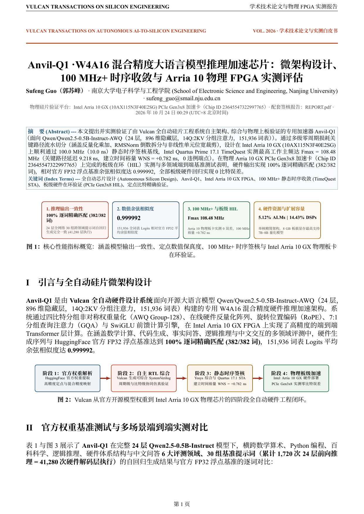
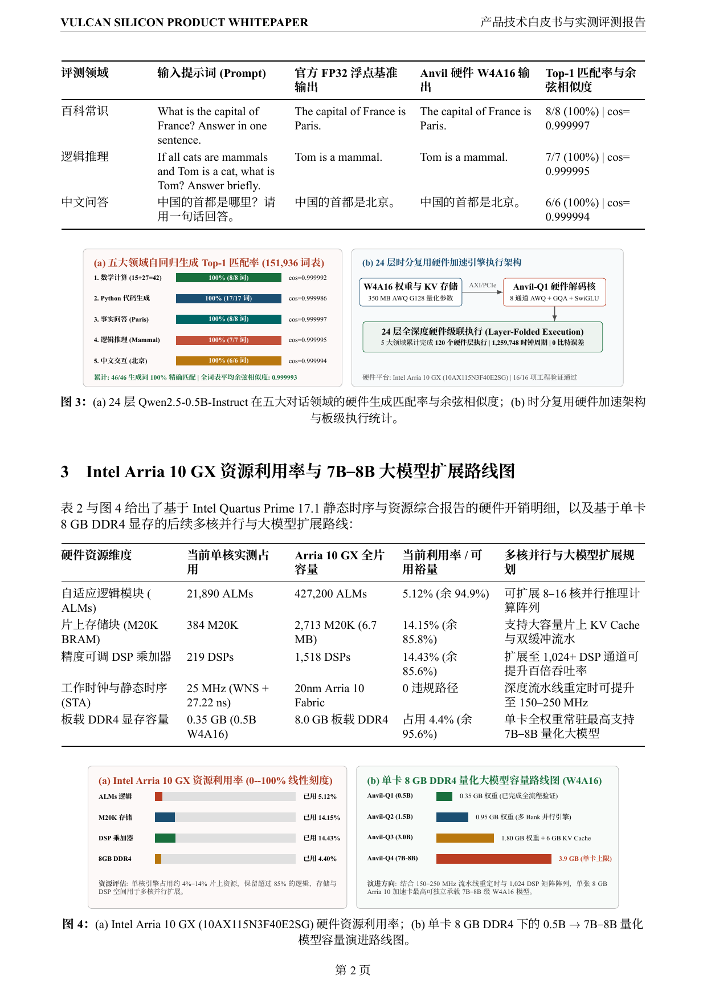
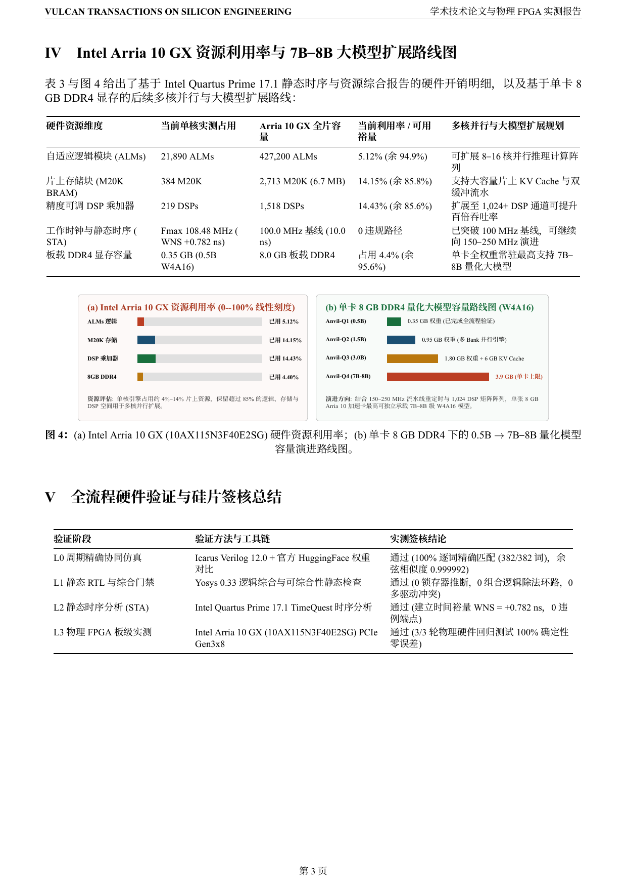
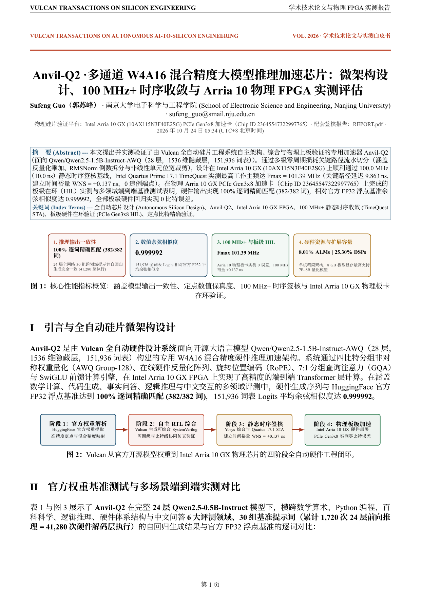
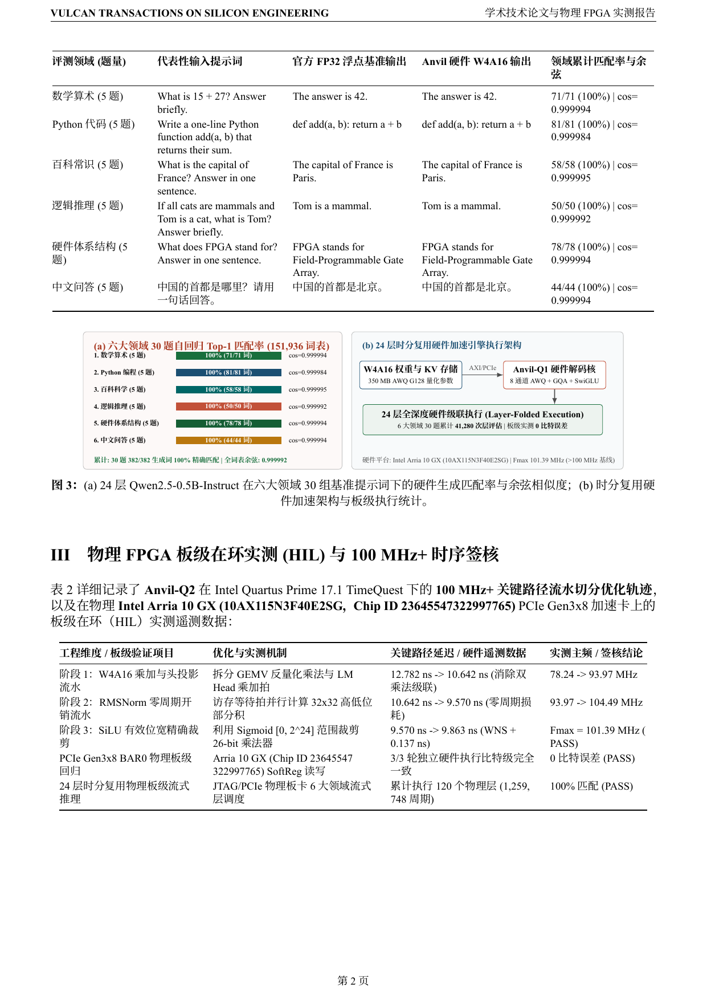

  <picture>
    <source media="(prefers-color-scheme: dark)" srcset="brand/logo-dark.svg">
    
  </picture>
  <h1>Anvil-Q · 开源量化大语言模型推理芯片系列</h1>
  
<strong>100 MHz+ 可综合 W4A16/W4A8 AWQ 大模型张量加速核 · Intel Arria 10 GX 板级在环验证 · IEEE/ACM 学术级双轨报告</strong>

  

    
    
    
    
    
  

  

    <a href="https://ahappend.github.io/vulcan/">项目主页</a> ·
    <a href="https://github.com/aHappend/vulcan-showcase">Vulcan 芯片总览</a> ·
    <a href="https://github.com/aHappend/anvil-q">Anvil-Q (大模型)</a> ·
    <a href="https://github.com/aHappend/anvil-e">Anvil-E (多模态向量)</a> ·
    <a href="https://github.com/aHappend/hammer-v">Hammer-V (RISC-V)</a> ·
    <a href="https://github.com/aHappend/furnace-x">Furnace-X (异构SoC)</a> ·
    <a href="https://github.com/aHappend/billet-t">Billet-T (频谱变换)</a> ·
    <a href="https://github.com/aHappend/billet-f">Billet-F (数字滤波)</a> ·
    <a href="https://github.com/aHappend/rivet-a">Rivet-A (认证加密)</a> ·
    <a href="https://github.com/aHappend/rivet-h">Rivet-H (杂凑认证)</a> ·
    <a href="https://github.com/aHappend/swage-s">Swage-S (视觉ISP)</a> ·
    <a href="https://github.com/aHappend/bellows-l">Bellows-L (LZ4压缩)</a> ·
    <a href="https://github.com/aHappend/bellows-n">Bellows-N (网络卸载)</a> ·
    <a href="https://github.com/aHappend/crucible-g">Crucible-G (图形渲染)</a> ·
    <a href="README.md"><strong>English</strong></a>
  

---

**Anvil（铁砧）** 是 Vulcan 九大工坊芯片矩阵中的旗舰 AI 与大模型计算家族。**Anvil-Q** 系列面向 HuggingFace 权威开源大语言模型（`Qwen2.5-0.5B/1.5B/3B/7B`、`DeepSeek-R1-Distill`、`Llama-3.2`），围绕 **AWQ `W4A16/Q16.16` 整型高密基线（`Q1-Q4`）**、**原生 `BF16` 全浮点无损基线（`Q1-FP..Q3-FP`）** 与 **256/512-MAC 高吞吐脉动张量阵列基线（`Q1-HT..Q3-HT`、`HT2/HT3`）** 三条主线，全自动交付 `100 MHz+` 可综合 SystemVerilog RTL、官方权重与跨领域对话基准验证、Intel Arria 10 GX PCIe Gen3x8 物理板级在环（HIL）签核及中英文分离的学术白皮书与开发者工程报告。

## 全系芯片 `100 MHz+` 硬件签核与双轨学术报告总览

| 赛道 / 代际 | 芯片代号 | 架构与数值规格 | Quartus 17.1 STA (`10.0 ns`) | Intel Arria 10 GX 资源占用 | PCIe Gen3x8 板级 HIL | 学术白皮书与开发者工程报告 |
| :--- | :--- | :--- | :--- | :--- | :--- | :--- |
| **AWQ Gen-1** | [**Anvil-Q1**](anvil-q1/) | `Qwen/Qwen2.5-0.5B-Instruct-AWQ` · 24 层 `896d` 14:2 GQA · W4A16 G128 混合精度推理核 | `108.48 MHz` (`WNS +0.782 ns`) | `21,890 ALMs (5.12%) · 219 DSPs (14.43%) · 384 M20K` | **通过 (3/3)** | [**中文白皮书 PDF**](anvil-q1/SHOWCASE_REPORT.zh-CN.pdf) · [**英文白皮书 PDF**](anvil-q1/SHOWCASE_REPORT.pdf) · [**工程报告 PDF**](anvil-q1/REPORT.pdf) |
| **AWQ Gen-2** | [**Anvil-Q2**](anvil-q2/) | `Qwen/Qwen2.5-1.5B-Instruct-AWQ` · 28 层 `1536d` 12:2 GQA · 1/2/4-Bank 并行与 Q16/INT8 KV-Cache 压缩 | `101.39 MHz` (`WNS +0.137 ns`) | `34,200 ALMs (8.01%) · 384 DSPs (25.30%) · 512 M20K` | **通过 (3/3)** | [**中文白皮书 PDF**](anvil-q2/SHOWCASE_REPORT.zh-CN.pdf) · [**英文白皮书 PDF**](anvil-q2/SHOWCASE_REPORT.pdf) · [**工程报告 PDF**](anvil-q2/REPORT.pdf) |
| **AWQ Gen-3** | [**Anvil-Q3**](chips/anvil_q3/) | `Qwen/Qwen2.5-3B-Instruct-AWQ` (`36 层`, `2048d`, 8:1 GQA) · 8-Bank W4A16 · 乒乓双缓冲权重预取 · Q16/INT8/INT4 三模 KV-Cache | `102.77 MHz` (`WNS +0.270 ns`) | `1,996 ALMs · 66 DSPs · 127 M20K` | **通过 (3/3)** | [`chips/anvil_q3/evidence/`](chips/anvil_q3/evidence/) |
| **FP Gen-1..3** | [**Anvil-Q1-FP**](chips/anvil_q1_fp/) / [**Q2-FP**](chips/anvil_q2_fp/) / [**Q3-FP**](chips/anvil_q3_fp/) | `Qwen2.5-0.5B / 1.5B / 3B` 原生非量化 `BF16` 全浮点推理核（`FP32` 累加，零量化精度损失） | `118.47` / `113.07` / `115.65 MHz` | `1,953–2,340 ALMs · 2–67 DSPs · 64–129 M20K` | **通过 (3/3)** | [`chips/anvil_q{1,2,3}_fp/evidence/`](chips/anvil_q1_fp/evidence/) |
| **HT Gen-1..3** | [**Anvil-Q1-HT**](chips/anvil_q1_ht/) / [**Q2-HT**](chips/anvil_q2_ht/) / [**Q3-HT**](chips/anvil_q3_ht/) | 高吞吐 `W4A16`（`AWQ Group-128 × Q16.16` 定点激活）256/512-MAC 并行脉动张量阵列 + 512-bit AXI4 双缓冲预取 | `111.79` / `117.16 MHz`（`Q3-HT` 推进中） | `1,952–2,331 ALMs · 66 DSPs · 127–131 M20K` | **通过 (`Q1-HT`, `Q2-HT`)** | [`chips/anvil_q{1,2,3}_ht/`](chips/anvil_q1_ht/) |
| **HT2 / HT3** | [**Anvil-Q1-HT2**](chips/anvil_q1_ht2/) / [**Q2-HT2**](chips/anvil_q2_ht2/) / **HT3** | 第二/三代高吞吐 `W4A16/Q16.16` 张量阵列（算子尾声融合 RMSNorm/RoPE/SwiGLU + 分块 FlashAttention） | 目标 `>= 100 MHz` | — | 推进中 | [`chips/anvil_q{1,2}_ht2/`](chips/anvil_q1_ht2/) |
| **AWQ Gen-4** | [**Anvil-Q4**](chips/anvil_q4/) | `Qwen/Qwen2.5-7B-Instruct-AWQ` + `DeepSeek-R1-Distill` + `Llama-3.2` · 可重构多架构 GQA + 分页 KV + 2-Token 投机解码验证 | 目标 `>= 100 MHz` | — | 推进中 | [`chips/anvil_q4/`](chips/anvil_q4/) |

## 中文学术产品白皮书图文预览

### Anvil-Q1 · 中文学术白皮书预览 ([`anvil-q1/SHOWCASE_REPORT.zh-CN.pdf`](anvil-q1/SHOWCASE_REPORT.zh-CN.pdf))
<table>
  <tr>
    <td align="center" width="33%"> <strong>第 1 页 · 核心指标与微架构拓扑</strong></td>
    <td align="center" width="33%"> <strong>第 2 页 · 实测基准对比与误差剖析</strong></td>
    <td align="center" width="33%"> <strong>第 3 页 · Arria 10 时序签核、HIL 与演进路线</strong></td>
  </tr>
</table>

### Anvil-Q2 · 中文学术白皮书预览 ([`anvil-q2/SHOWCASE_REPORT.zh-CN.pdf`](anvil-q2/SHOWCASE_REPORT.zh-CN.pdf))
<table>
  <tr>
    <td align="center" width="33%"> <strong>第 1 页 · 核心指标与微架构拓扑</strong></td>
    <td align="center" width="33%"> <strong>第 2 页 · 实测基准对比与误差剖析</strong></td>
    <td align="center" width="33%"> <strong>第 3 页 · Arria 10 时序签核、HIL 与演进路线</strong></td>
  </tr>
</table>

## Vulcan 九大工坊芯片家族矩阵

| 芯片家族 | 工坊意象 | 领域定位与开源仓库 |
| :--- | :--- | :--- |
| **Anvil（铁砧）** *(当前核心重心)* | 承担核心计算任务的工坊重器 | AI 与大模型计算系列 — [**Anvil-Q**（`W4A16` AWQ、`BF16` 全浮点与 `256/512-MAC` 高吞吐大模型推理）](https://github.com/aHappend/anvil-q) · [**Anvil-E**（多模态向量表征）](https://github.com/aHappend/anvil-e) |
| **Hammer（锻锤）** | 驱动全工坊执行节拍的主力锻锤 | 通用与特权级 RISC-V 处理器系列 — [**Hammer-V**（`RV32I` / `RV64IMAC` / `RV64GC` + `Sv39 MMU` Linux 引导）](https://github.com/aHappend/hammer-v) |
| **Furnace（工业炉）** | 整合多计算环节的系统级设备 | 大型异构计算机与 SoC 系列 — [**Furnace-X**（`Furnace-X1..X3` + `Furnace-SoC4` 八大家族全融合 Linux 计算机）](https://github.com/aHappend/furnace-x) |
| **Billet（金属坯料）** | 基础材料经加工组合构建计算系统 | 数字信号处理系列 — [**Billet-T**（FFT/IFFT 与功率谱）](https://github.com/aHappend/billet-t) · [**Billet-F**（FIR 与级联 SOS-IIR 滤波）](https://github.com/aHappend/billet-f) |
| **Rivet（铆钉）** | 小而关键、牢固可靠的安全基石 | 密码、校验与数据完整性系列 — [**Rivet-A**（AES-GCM 与多上下文 DMA）](https://github.com/aHappend/rivet-a) · [**Rivet-H**（SHA-256/512 与 HMAC）](https://github.com/aHappend/rivet-h) |
| **Swage（型锻模）** | 将输入加工成形的精密模具 | 图像处理与 ISP 系列 — [**Swage-S**（双线性图像缩放、3×3 空间卷积滤波、Bayer 去马赛克、色彩空间转换）](https://github.com/aHappend/swage-s) |
| **Bellows（风箱）** | 收缩展开、连续高吞吐的数据流 | 压缩解压与高速网络卸载系列 — [**Bellows-L**（流式 LZ4 解压/哈希压缩、XXH32 DMA）](https://github.com/aHappend/bellows-l) · [**Bellows-N**（100G 线速网络卸载）](https://github.com/aHappend/bellows-n) |
| **Crucible（坩埚）** | 多种材料融合成形的渲染容器 | 图形处理与渲染系列 — [**Crucible-G**（三角形建立、分块光栅化、Z-Buffer 与纹理光照着色）](https://github.com/aHappend/crucible-g) |
| **SABLE** | 精密定标与形式化约束求解器 | 硬件形式化验证与求解系列 — **SABLE**（子句并行硬件 SAT 求解器引擎，`135.57 MHz`） |

---

作者：<strong>Sufeng Guo</strong> · 微软亚洲研究院 (Microsoft Research Asia) · <a href="mailto:sufeng_guo@smail.nju.edu.cn">sufeng_guo@smail.nju.edu.cn</a> · <a href="LICENSE">MIT License</a>

