# Vulcan product report

[Developer Engineering Report (PDF)](REPORT.pdf) | [LaTeX source](REPORT.tex) | [Executive & Public Showcase Whitepaper (PDF)](SHOWCASE_REPORT.pdf) | [Showcase Markdown](SHOWCASE_REPORT.md)

[English engineering journey](.vulcan/engineering/JOURNEY.md) | [Chinese companion](.vulcan/engineering/JOURNEY.zh-CN.md)

[Source and evidence manifest](.vulcan/engineering/reports/report-0006/manifest.json)

[Rendered-PDF review](.vulcan/engineering/reports/report-0006/role-render-01-reviewer/response.json) | [Page-access and artifact binding](.vulcan/engineering/reports/report-0006/render-approval.json)

Historical generation attempt: `report-0006`; this is not a hardware version number. The report reflects the independently accepted source/check identity recorded in its manifest. Later source changes require revalidation. Original failures and previous report attempts remain retained.

## Illustrated Report Pages (TikZ / pgfplots Diagrams & Hardware Evidence)

### Page 1
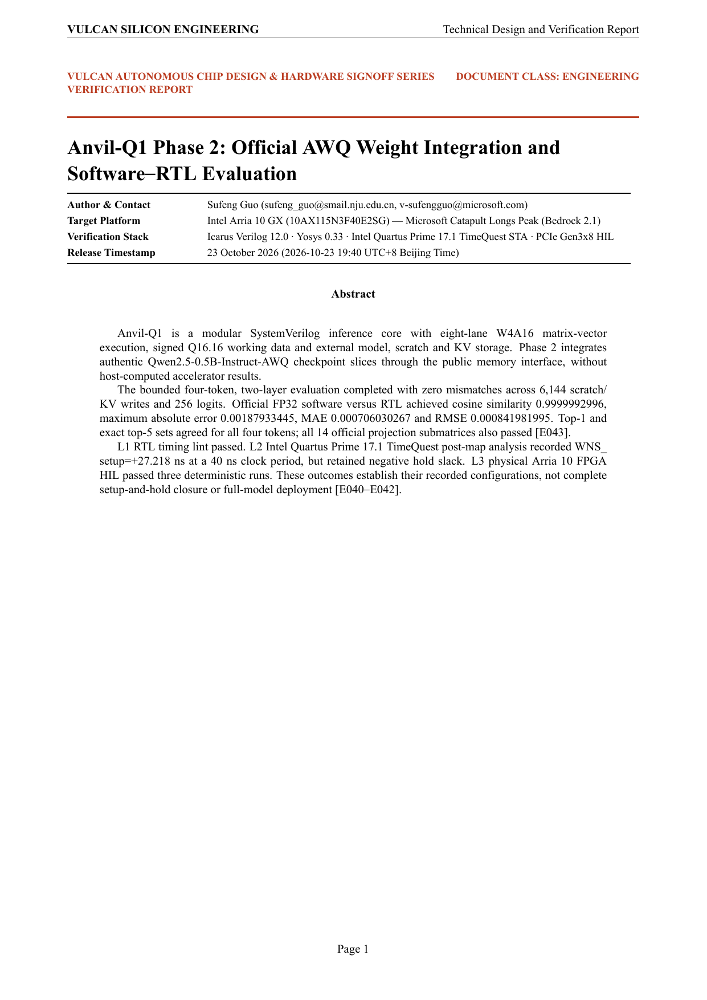

### Page 2
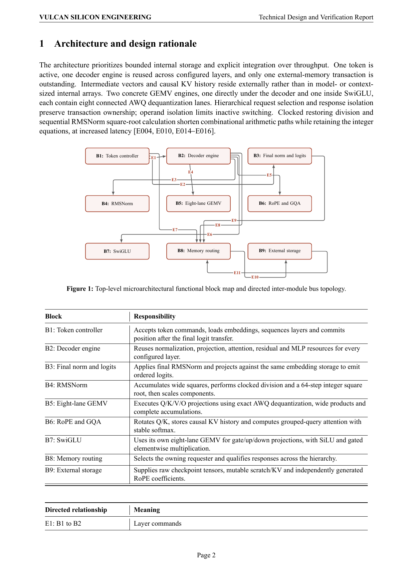

### Page 3
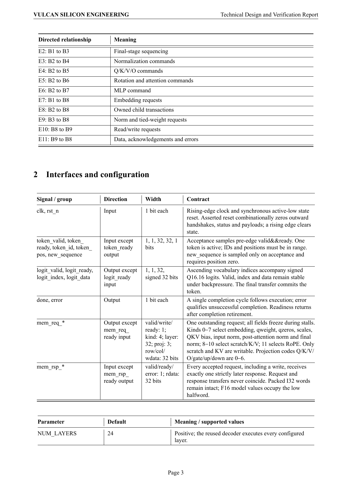

### Page 4
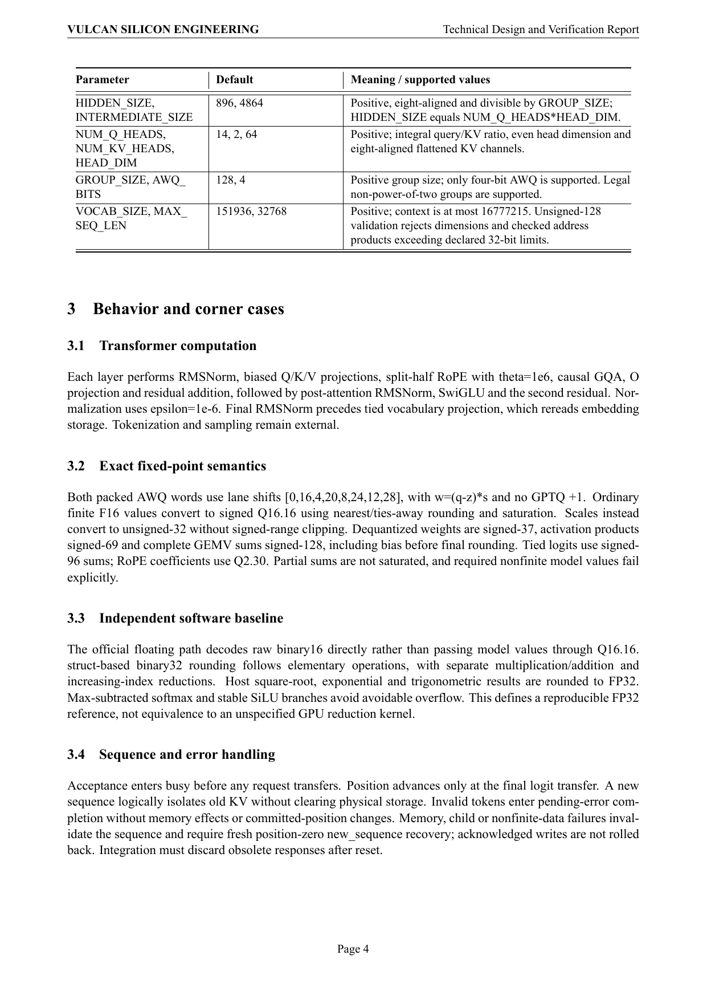

### Page 5
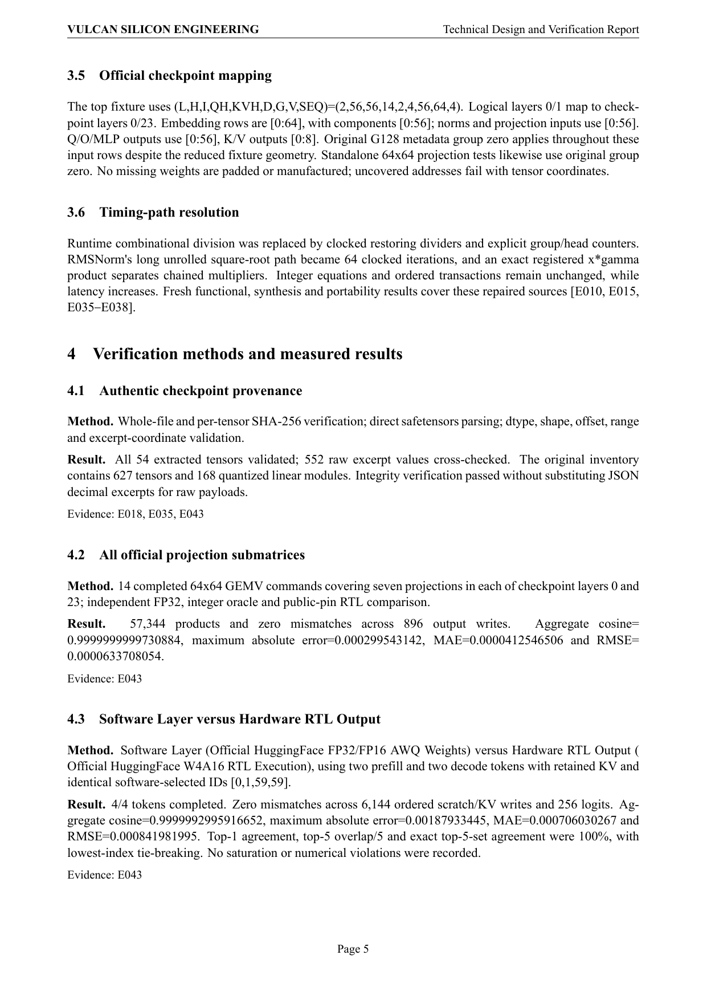

### Page 6
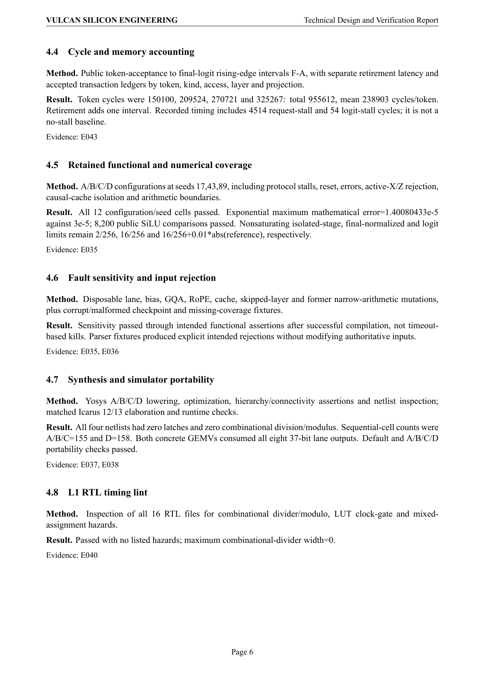

### Page 7
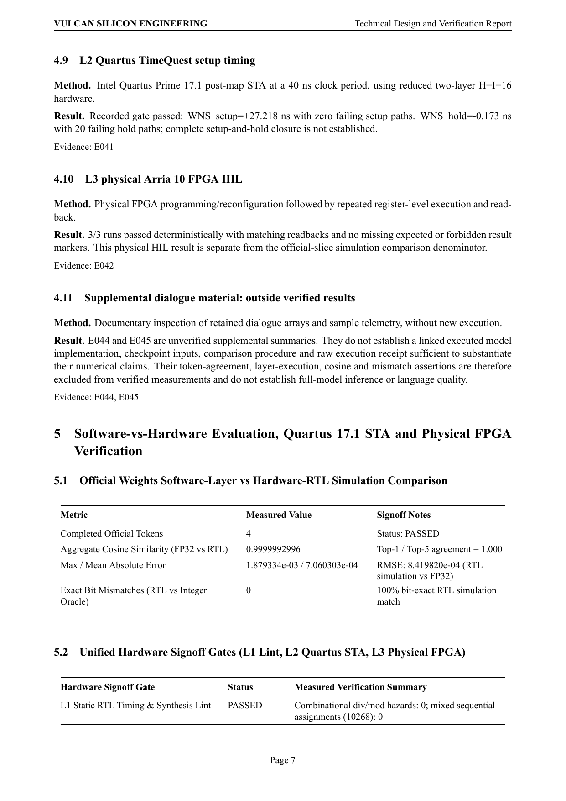

### Page 8
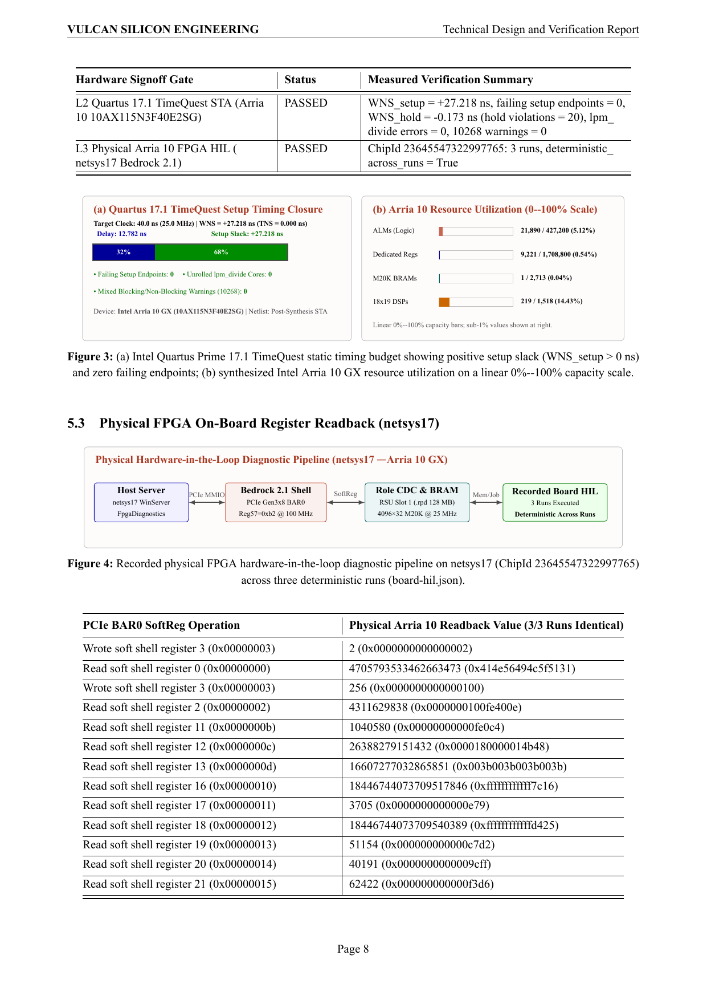

### Page 9
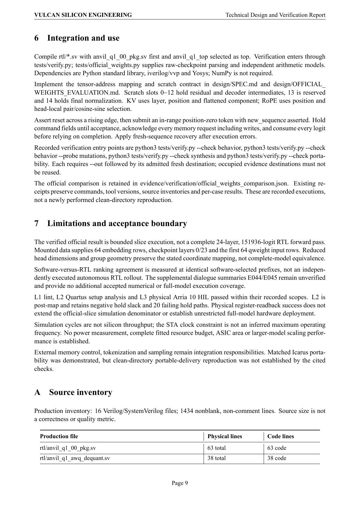

### Page 10
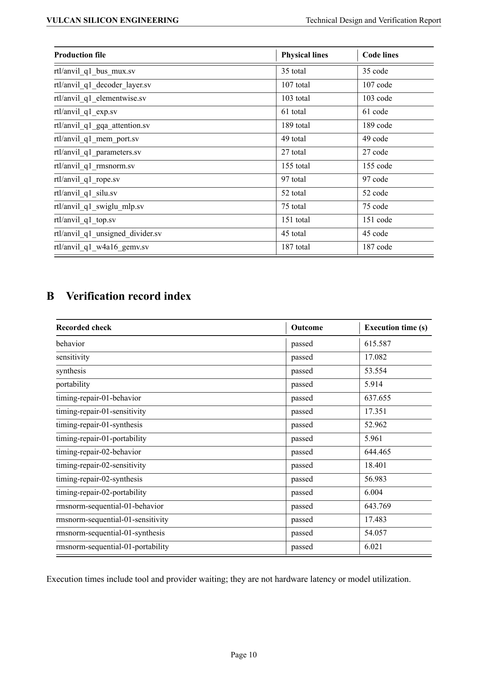

### Page 11
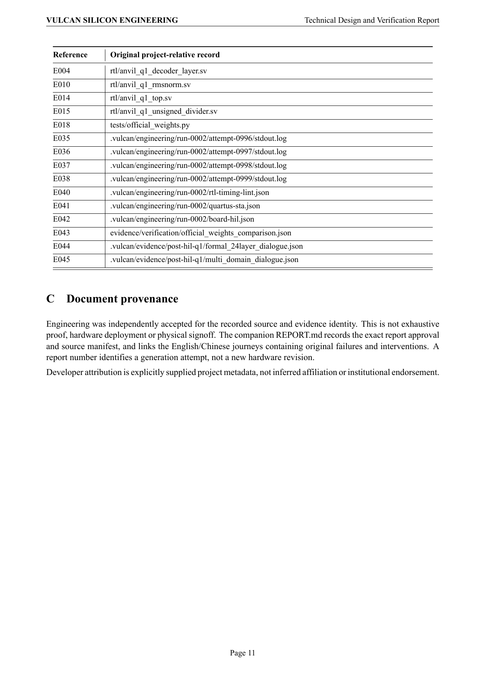
