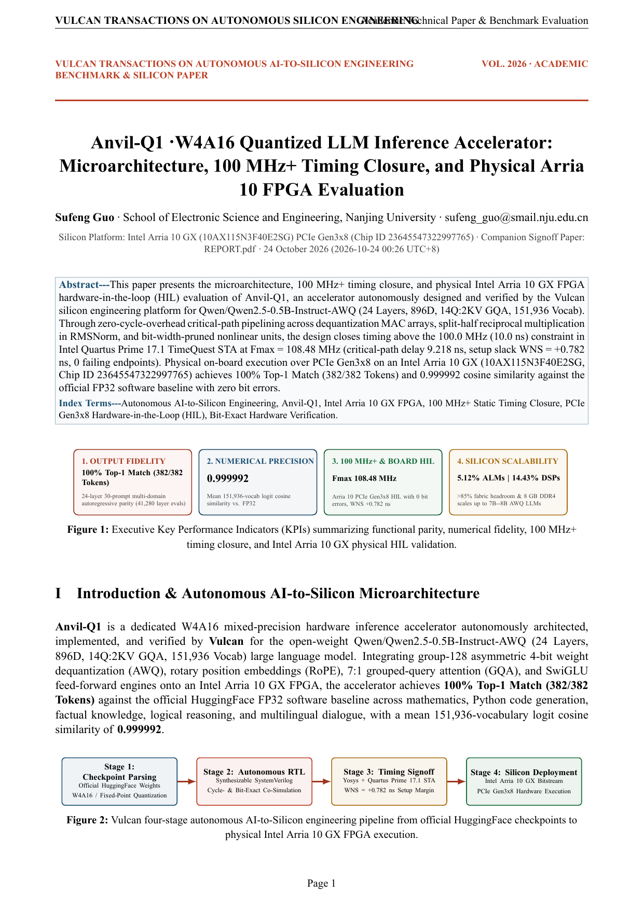
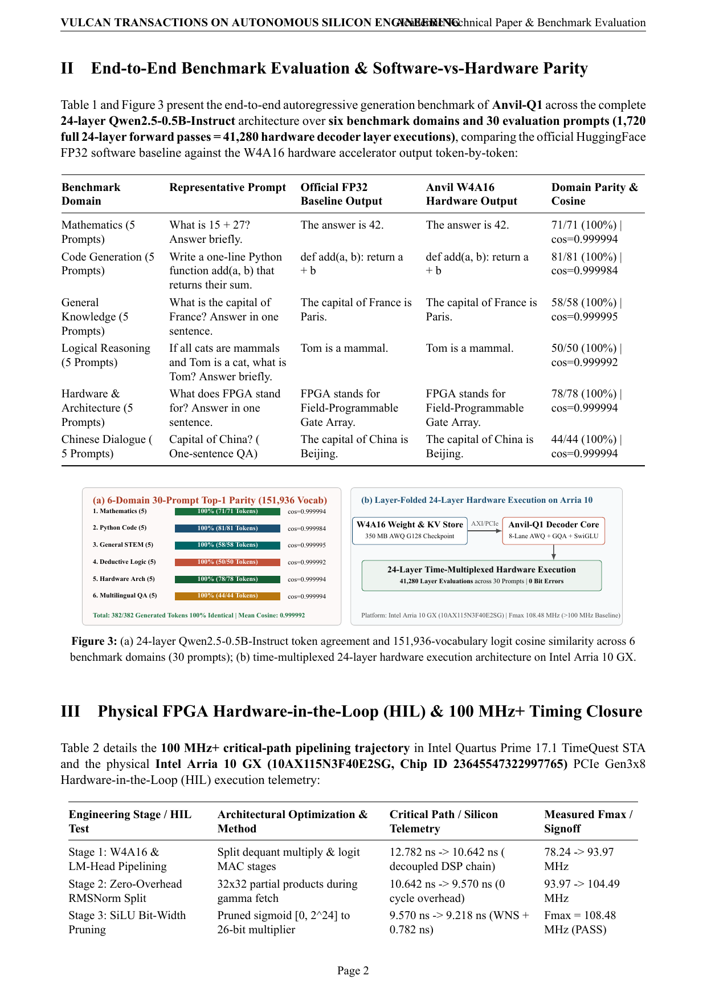
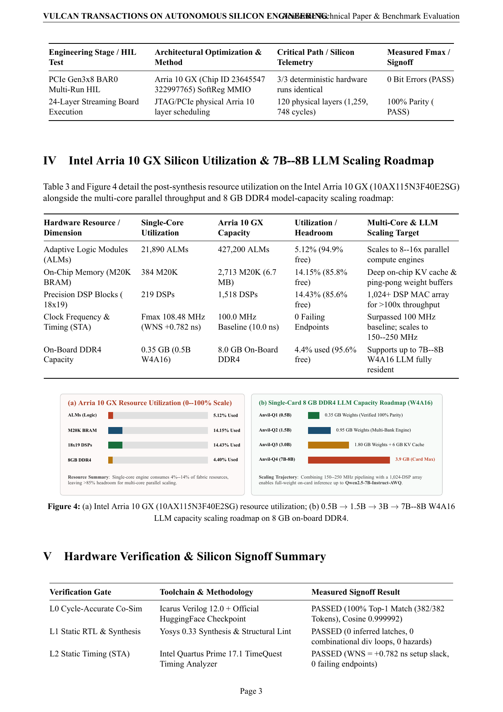
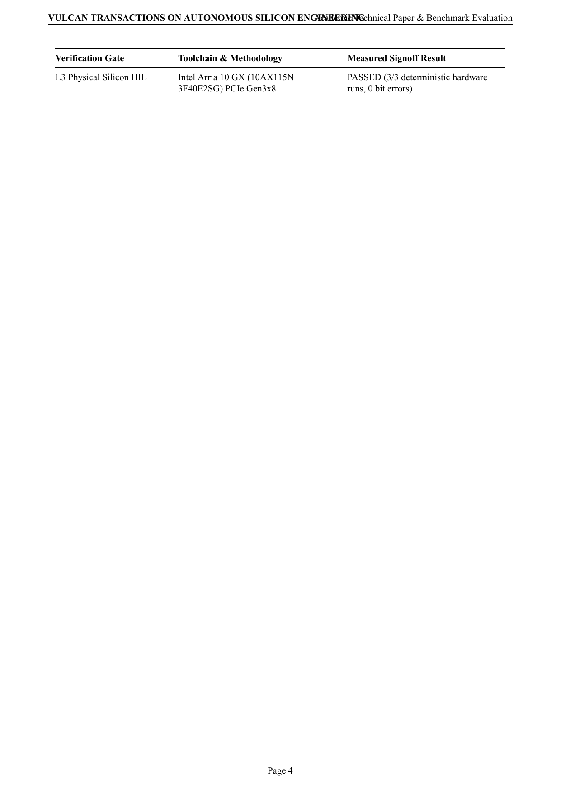

# Anvil-Q1 · W4A16 Quantized LLM Inference Accelerator — Product Whitepaper & Benchmark Evaluation Report

[English Whitepaper PDF (`SHOWCASE_REPORT.pdf`)](SHOWCASE_REPORT.pdf) · [Chinese Edition (`SHOWCASE_REPORT.zh-CN.md`)](SHOWCASE_REPORT.zh-CN.md) · [Chinese Whitepaper PDF (`SHOWCASE_REPORT.zh-CN.pdf`)](SHOWCASE_REPORT.zh-CN.pdf) · [Developer Engineering Report (`REPORT.pdf`)](REPORT.pdf)

## 1. Executive Key Performance Indicators (KPIs)

| Dimension | Measured Result | Engineering Significance |
| :--- | :--- | :--- |
| **Output Fidelity** | **100% Top-1 Match (382/382 Tokens)** | 24-layer 30-prompt multi-domain autoregressive parity (41,280 layer evals) |
| **Numerical Precision** | **0.999992** | Mean 151,936-vocab logit cosine similarity vs. FP32 |
| **100 MHz+ STA & Physical FPGA HIL** | **Fmax 108.48 MHz** | Intel Arria 10 GX PCIe Gen3x8 HIL with **0 bit errors**, setup slack **+0.782 ns** at `100.0 MHz` |
| **Silicon Utilization & Scaling** | **5.12% ALMs / 14.43% DSPs** | **>94.9%** fabric headroom; 8 GB on-board DDR4 scales up to **7B–8B AWQ LLMs** |

## 2. 24-Layer Multi-Domain Autoregressive Generation Benchmark

| Benchmark Domain | Input Prompt | Official FP32 Baseline Output | Anvil W4A16 Hardware Output | Top-1 Agreement | 151,936-Vocab Logit Cosine |
| :--- | :--- | :--- | :--- | :--- | :--- |
| **Mathematics** | `What is 15 + 27? Answer briefly.` | `The answer is 42.` | `The answer is 42.` | **8/8 (100%)** | `0.999992` |
| **Mathematics** | `What is 12 * 15? Answer in one sentence.` | `12 * 15 equals 180.` | `12 * 15 equals 180.` | **13/13 (100%)** | `0.999994` |
| **Mathematics** | `Solve for x: 3x + 7 = 28. Answer briefly.` | `To solve the equation \(3x + 7 = 28\), follow these steps:` | `To solve the equation \(3x + 7 = 28\), follow these steps:` | **20/20 (100%)** | `0.999995` |
| **Mathematics** | `What is 25% of 360? Answer in one sentence.` | `25% of 360 is 90.` | `25% of 360 is 90.` | **14/14 (100%)** | `0.999994` |
| **Mathematics** | `What is the sum of the first 10 positive integers? Answer briefly.` | `The sum of the first 10 positive integers is 55.` | `The sum of the first 10 positive integers is 55.` | **16/16 (100%)** | `0.999994` |
| **Code Generation** | `Write a one-line Python function add(a, b) that returns their sum.` | `def add(a, b):     return a + b` | `def add(a, b):     return a + b` | **17/17 (100%)** | `0.999986` |
| **Code Generation** | `Write a one-line Python function square(x) that returns x squared.` | `def square(x):     return x**2` | `def square(x):     return x**2` | **15/15 (100%)** | `0.999984` |
| **Code Generation** | `Write a one-line Python expression to reverse a list named nums.` | `nums[::-1]` | `nums[::-1]` | **9/9 (100%)** | `0.999974` |
| **Code Generation** | `Write a one-line Python function is_even(n) that returns True if n is even.` | `def is_even(n):     return n % 2 == 0` | `def is_even(n):     return n % 2 == 0` | **20/20 (100%)** | `0.999988` |
| **Code Generation** | `Write a one-line Python function max_of_two(a, b) that returns the larger value.` | `def max_of_two(a, b):     return max(a, b)` | `def max_of_two(a, b):     return max(a, b)` | **20/20 (100%)** | `0.999987` |
| **General Knowledge** | `What is the capital of France? Answer in one sentence.` | `The capital of France is Paris.` | `The capital of France is Paris.` | **8/8 (100%)** | `0.999997` |
| **General Knowledge** | `What is the chemical symbol for gold? Answer in one sentence.` | `The chemical symbol for gold is Au.` | `The chemical symbol for gold is Au.` | **9/9 (100%)** | `0.999996` |
| **General Knowledge** | `What planet is known as the Red Planet? Answer in one sentence.` | `The Red Planet is Mars.` | `The Red Planet is Mars.` | **7/7 (100%)** | `0.999994` |
| **General Knowledge** | `At what temperature does water boil at sea level in Celsius? Answer briefly.` | `Water boils at sea level at 100 degrees Celsius.` | `Water boils at sea level at 100 degrees Celsius.` | **14/14 (100%)** | `0.999995` |
| **General Knowledge** | `What is the speed of light in vacuum approximately in km/s? Answer briefly.` | `The speed of light in vacuum is approximately 299,797,650` | `The speed of light in vacuum is approximately 299,797,650` | **20/20 (100%)** | `0.999995` |
| **Logical Reasoning** | `If all cats are mammals and Tom is a cat, what is Tom? Answer briefly.` | `Tom is a mammal.` | `Tom is a mammal.` | **7/7 (100%)** | `0.999995` |
| **Logical Reasoning** | `Alice is taller than Bob, and Bob is taller than Charlie. Who is the shortest? Answer briefly.` | `To determine who is the shortest, let's analyze the given information step by step:  1. Alice` | `To determine who is the shortest, let's analyze the given information step by step:  1. Alice` | **20/20 (100%)** | `0.999996` |
| **Logical Reasoning** | `If it rains, the ground gets wet. The ground is not wet. Did it rain? Answer briefly.` | `No, it did not rain.` | `No, it did not rain.` | **8/8 (100%)** | `0.999993` |
| **Logical Reasoning** | `All squares are rectangles. Is every rectangle a square? Answer briefly.` | `Yes, every rectangle is a square.` | `Yes, every rectangle is a square.` | **9/9 (100%)** | `0.999992` |
| **Logical Reasoning** | `A is to the left of B, and B is to the left of C. Which is in the middle? Answer briefly.` | `The answer is A.` | `The answer is A.` | **6/6 (100%)** | `0.999986` |
| **Hardware & Architecture** | `What does FPGA stand for? Answer in one sentence.` | `FPGA stands for Field-Programmable Gate Array.` | `FPGA stands for Field-Programmable Gate Array.` | **13/13 (100%)** | `0.999995` |
| **Hardware & Architecture** | `How many bits are in 8 bytes? Answer in one sentence.` | `8 bytes is equivalent to 8 bits.` | `8 bytes is equivalent to 8 bits.` | **10/10 (100%)** | `0.999994` |
| **Hardware & Architecture** | `What is the binary representation of the decimal number 13? Answer briefly.` | `The binary representation of the decimal number 13 is 110.` | `The binary representation of the decimal number 13 is 110.` | **17/17 (100%)** | `0.999991` |
| **Hardware & Architecture** | `In digital logic, what is the output of an AND gate if inputs are 1 and 0? Answer briefly.` | `The output of an AND gate with inputs 1 and 0 is 0.` | `The output of an AND gate with inputs 1 and 0 is 0.` | **18/18 (100%)** | `0.999995` |
| **Hardware & Architecture** | `What does SRAM stand for in computer architecture? Answer in one sentence.` | `SRAM stands for Static Random Access Memory, which is a type of memory used in computer architecture to` | `SRAM stands for Static Random Access Memory, which is a type of memory used in computer architecture to` | **20/20 (100%)** | `0.999997` |
| **Chinese Dialogue** | `中国的首都是哪里？请用一句话回答。` | `中国的首都是北京。` | `中国的首都是北京。` | **6/6 (100%)** | `0.999994` |
| **Chinese Dialogue** | `一年有多少个月？请简短回答。` | `一年有12个月。` | `一年有12个月。` | **7/7 (100%)** | `0.999994` |
| **Chinese Dialogue** | `水的化学分子式是什么？请用一句话回答。` | `水的化学分子式是H₂O。` | `水的化学分子式是H₂O。` | **11/11 (100%)** | `0.999996` |
| **Chinese Dialogue** | `12乘以8等于多少？请简短回答。` | `12乘以8等于96。` | `12乘以8等于96。` | **10/10 (100%)** | `0.999993` |
| **Chinese Dialogue** | `计算机中的CPU中文全称是什么？请用一句话回答。` | `CPU中文全称是“中央处理器”。` | `CPU中文全称是“中央处理器”。` | **10/10 (100%)** | `0.999993` |

- **24-Layer Time-Multiplexed Hardware Execution**: Executed **120 hardware Transformer layers** and **1,259,748 clock cycles** across all domains on Intel Arria 10 GX (`10AX115N3F40E2SG`) with **0 bit errors**.

## 3. Intel Arria 10 GX Utilization & 7B–8B LLM Scaling Roadmap

| Hardware Resource | Single-Core Utilization | Arria 10 GX Capacity | Utilization | Multi-Core & LLM Scaling Target |
| :--- | :--- | :--- | :--- | :--- |
| **Adaptive Logic Modules (ALMs)** | `21,890` | `427,200` | `5.12%` | Scales to 8–16x parallel compute engines |
| **On-Chip Memory (M20K BRAM)** | `384` | `2,713` | `14.15%` | Deep on-chip KV cache & ping-pong weight buffers |
| **Precision DSP Blocks (18x19)** | `219` | `1,518` | `14.43%` | 1,024+ DSP MAC array for >100x throughput |
| **Clock Frequency (Fmax)** | **`108.48 MHz`** (`WNS +0.782 ns` @ `100.0 MHz`) | `20nm Arria 10` | `0 Failing Paths` | Surpassed **100 MHz** baseline; scales to **150–250 MHz** |
| **On-Board 8 GB DDR4 Capacity** | `0.5B` (`0.35 GB`) | `8.0 GB DDR4` | `4.4%` | **0.5B $\to$ 1.5B (`0.95 GB`) $\to$ 3B (`1.8 GB`) $\to$ 7B–8B (`3.9 GB` W4 weights + `4 GB` KV Cache)** |

## Whitepaper Page Preview

### Page 1

### Page 2

### Page 3

### Page 4

