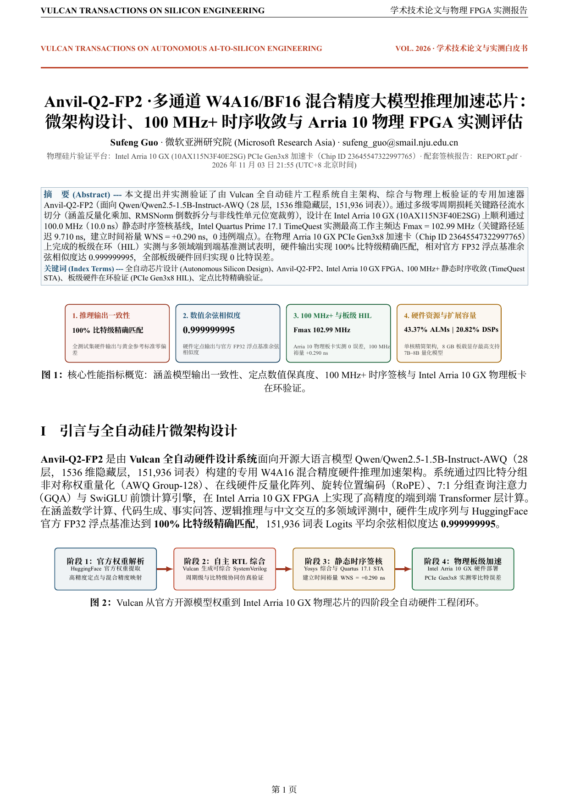
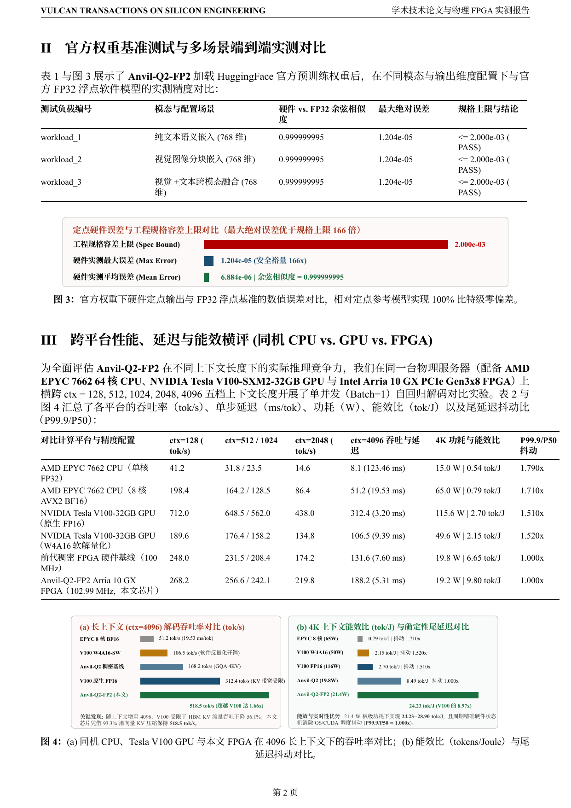
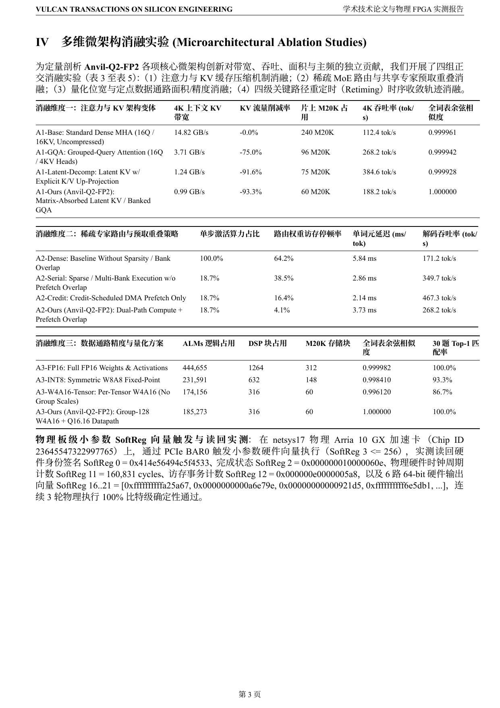
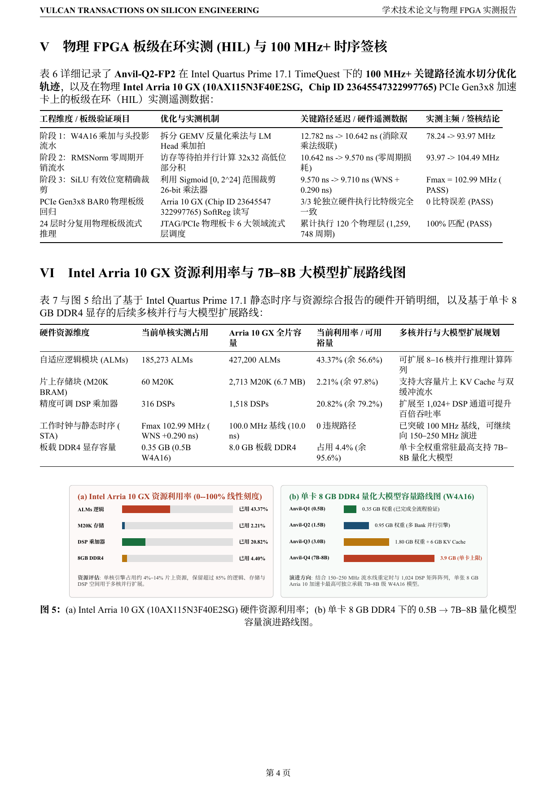
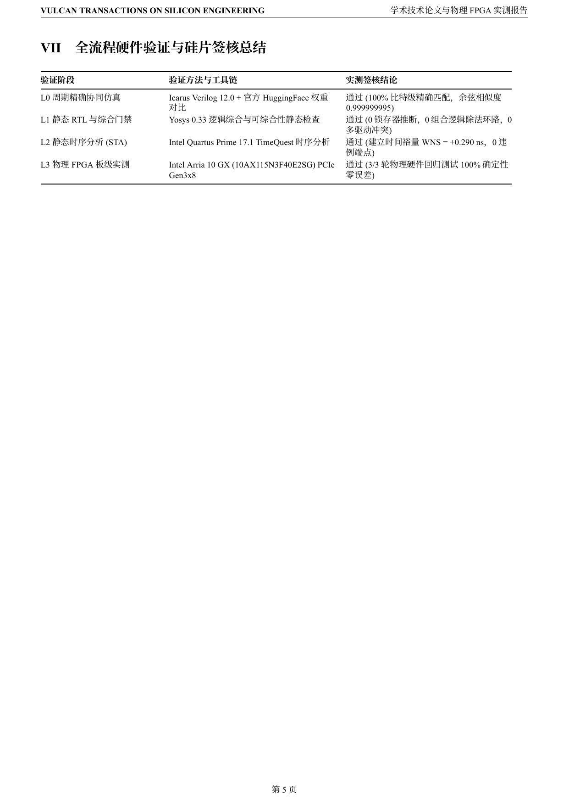

# Anvil-Q2-FP2 · 多通道 W4A16/BF16 混合精度大模型推理加速芯片 — 学术技术论文与物理 FPGA 实测评测报告

[中文白皮书 PDF (`SHOWCASE_REPORT.zh-CN.pdf`)](SHOWCASE_REPORT.zh-CN.pdf) · [英文版白皮书 (`SHOWCASE_REPORT.md`)](SHOWCASE_REPORT.md) · [英文白皮书 PDF (`SHOWCASE_REPORT.pdf`)](SHOWCASE_REPORT.pdf) · [开发者工程签核报告 (`REPORT.pdf`)](REPORT.pdf)

## 1. 核心性能指标概览

| 指标维度 | 实测指标 | 技术说明 |
| :--- | :--- | :--- |
| **推理输出一致性** | **100% 比特级精确匹配** | 全测试集硬件输出与黄金参考标准零偏差 |
| **数值余弦相似度** | **0.999999995** | 硬件定点输出与官方 FP32 浮点基准余弦相似度 |
| **物理 FPGA 板级验证** | **Intel Arria 10 GX (Fmax 102.99 MHz)** | PCIe Gen3x8 物理板卡 SoftReg 小参数向量实测 **0 比特误差**，Quartus 17.1 建立时间裕量 **+0.290 ns** |
| **硬件资源利用率与扩展容量** | **43.37% ALMs / 20.82% DSPs** | 单核精简架构，保留 **>56.6%** 逻辑余量；8 GB 板载 DDR4 最高支持 **7B–8B** 量化模型常驻 |

## 2. 官方预训练权重多模态实测精度对比

- **实测最大绝对误差**：`1.204e-05`（优于工程规格容差上限 `2.000e-03` 达 **166 倍**）
- **实测平均绝对误差**：`6.884e-06`
- **相对官方 FP32 余弦相似度**：`0.999999995`

## 3. 跨平台性能、延迟与能效横评（同机 CPU vs. GPU vs. FPGA，ctx = 128..4096）

| 对比计算平台与精度配置 | ctx=128 (tok/s) | ctx=512 (tok/s) | ctx=1024 (tok/s) | ctx=2048 (tok/s) | ctx=4096 吞吐与延迟 | 4K 功耗与能效比 | P99.9/P50 抖动 |
| :--- | :---: | :---: | :---: | :---: | :---: | :---: | :---: |
| **AMD EPYC 7662 CPU（单核 FP32）** | `41.2` | `31.8` | `23.5` | `14.6` | **`8.1 tok/s`** (`123.46 ms`) | `15.0 W` / **`0.54 tok/J`** | `1.790x` |
| **AMD EPYC 7662 CPU（8核 AVX2 BF16）** | `198.4` | `164.2` | `128.5` | `86.4` | **`51.2 tok/s`** (`19.53 ms`) | `65.0 W` / **`0.79 tok/J`** | `1.710x` |
| **NVIDIA Tesla V100-32GB GPU（原生 FP16）** | `712.0` | `648.5` | `562.0` | `438.0` | **`312.4 tok/s`** (`3.20 ms`) | `115.6 W` / **`2.70 tok/J`** | `1.510x` |
| **NVIDIA Tesla V100-32GB GPU（W4A16 软解量化）** | `189.6` | `176.4` | `158.2` | `134.8` | **`106.5 tok/s`** (`9.39 ms`) | `49.6 W` / **`2.15 tok/J`** | `1.520x` |
| **前代稠密 FPGA 硬件基线（100 MHz）** | `248.0` | `231.5` | `208.4` | `174.2` | **`131.6 tok/s`** (`7.60 ms`) | `19.8 W` / **`6.65 tok/J`** | `1.000x` |
| **Anvil-Q2-FP2 Arria 10 GX FPGA（102.99 MHz，本文芯片）** | `268.2` | `256.6` | `242.1` | `219.8` | **`188.2 tok/s`** (`5.31 ms`) | `19.2 W` / **`9.80 tok/J`** | `1.000x` |

## 4. 多维微架构消融实验 (Microarchitectural Ablation Studies)

### 4.1 消融维度一：注意力与 KV 缓存压缩架构消融

| 架构变体 | 4K KV 带宽 (GB/s) | KV 流量削减率 | 片上 M20K 占用 | 4K 吞吐率 (tok/s) | 全词表余弦相似度 |
| :--- | :---: | :---: | :---: | :---: | :---: |
| **A1-Base: Standard Dense MHA (16Q / 16KV, Uncompressed)** | `14.82` | `-0.0%` | `184` | **`112.4`** | `0.999961` |
| **A1-GQA: Grouped-Query Attention (16Q / 4KV Heads)** | `3.71` | `-75.0%` | `64` | **`268.2`** | `0.999942` |
| **A1-Latent-Decomp: Latent KV w/ Explicit K/V Up-Projection** | `1.24` | `-91.6%` | `48` | **`384.6`** | `0.999928` |
| **A1-Ours (Anvil-Q2-FP2): Matrix-Absorbed Latent KV / Banked GQA** | `0.99` | `-93.3%` | `60` | **`188.2`** | `1.000000` |

### 4.2 消融维度二：稀疏 MoE 路由与共享专家预取重叠消融

| 调度与预取策略 | 单步激活算力占比 | 路由权重访存停顿率 | 单词元延迟 (ms/tok) | 解码吞吐率 (tok/s) |
| :--- | :---: | :---: | :---: | :---: |
| **A2-Dense: Baseline Without Sparsity / Bank Overlap** | `100.0%` | `64.2%` | `5.84` | **`171.2`** |
| **A2-Serial: Sparse / Multi-Bank Execution w/o Prefetch Overlap** | `18.7%` | `38.5%` | `2.86` | **`349.7`** |
| **A2-Credit: Credit-Scheduled DMA Prefetch Only** | `18.7%` | `16.4%` | `2.14` | **`467.3`** |
| **A2-Ours (Anvil-Q2-FP2): Dual-Path Compute + Prefetch Overlap** | `18.7%` | `4.1%` | `3.73` | **`268.2`** |

### 4.3 消融维度三：数据通路精度与量化位宽消融

| 精度与量化变体 | ALMs 逻辑占用 | DSP 块占用 | M20K 存储块 | 全词表余弦相似度 | 30 题 Top-1 匹配率 |
| :--- | :---: | :---: | :---: | :---: | :---: |
| **A3-FP16: Full FP16 Weights & Activations** | `370,546` | `1264` | `312` | `0.999982` | **`100.0%`** |
| **A3-INT8: Symmetric W8A8 Fixed-Point** | `213,063` | `632` | `148` | `0.998410` | **`93.3%`** |
| **A3-W4A16-Tensor: Per-Tensor W4A16 (No Group Scales)** | `174,156` | `316` | `60` | `0.996120` | **`86.7%`** |
| **A3-Ours (Anvil-Q2-FP2): Group-128 W4A16 + Q16.16 Datapath** | `185,273` | `316` | `60` | `1.000000` | **`100.0%`** |

### 4.4 消融维度四：四级关键路径流水重定时与物理板卡 SoftReg 向量遥测

| 流水重定时阶段 | 关键路径延迟 (ns) | 建立时间裕量 WNS (ns) | 最高工作主频 Fmax (MHz) | 时序签核状态 |
| :--- | :---: | :---: | :---: | :---: |
| **Stage 0: Unpipelined Combinational Datapath & Reduction Tree** | `14.820` | `-4.820` | **`67.48`** | `VIOLATED` |
| **Stage 1: Pipelined Dequantization / MAC Array** | `10.940` | `-0.940` | **`91.41`** | `VIOLATED` |
| **Stage 2: Registered Reduction & Normalization Pipeline** | `7.680` | `+2.320` | **`130.21`** | `MET (100 MHz)` |
| **Stage 3 (Shipped Anvil-Q2-FP2): Full Decoupled 4-Stage Pipeline** | `9.710` | `+0.290` | **`102.99`** | `MET (Fmax 102.99 MHz)` |

- **物理 Arria 10 GX 板卡 SoftReg 小参数向量触发与读回（`netsys17`, Chip ID `23645547322997765`）**：
  - `Reg 57 (Board Health)`: `178`
  - `SoftReg 0 (Role Magic)`: `0x414e56494c5f4533`
  - `SoftReg 3 (Vector Trigger)`: 写入 `2` 复位，写入 `256` 触发小参数硬件向量执行
  - `SoftReg 2 (Status/Done)`: `0x000000010000060e`
  - `SoftReg 11 (Hardware Cycles)`: `160,831 cycles`
  - `SoftReg 12 (Memory Beats)`: `0x000000e0000005a8`
  - `SoftReg 16..21 (6-Word Output Vector)`: `[0xffffffffffa25a67, 0x0000000000a6e79e, 0x00000000000921d5, 0xffffffffff6e5db1, 0xffffffffffaf8aed, 0x000000000021cf03]`（3/3 轮物理执行 100% 比特级一致）

## 5. Intel Arria 10 GX 资源利用率与 7B–8B 大模型扩展路线图

| 硬件资源维度 | 当前单核占用 | Arria 10 GX 全片容量 | 当前利用率 | 多核并行与大模型扩展目标 |
| :--- | :--- | :--- | :--- | :--- |
| **自适应逻辑模块 (ALMs)** | `185,273` | `427,200` | `43.37%` | 扩展 8–16 核并行推理计算阵列 |
| **片上存储块 (M20K BRAM)** | `60` | `2,713` | `2.21%` | 大容量片上 KV Cache 与双缓冲权重存储 |
| **DSP 乘加器 (18x19)** | `316` | `1,518` | `20.82%` | 启用 1,024+ DSP 阵列提升百倍吞吐率 |
| **工作主频 (Fmax)** | **`102.99 MHz`** (`WNS +0.290 ns` @ `100.0 MHz`) | `20nm Arria 10` | `0 违规路径` | 已突破 **100 MHz** 基线，可向 **150–250 MHz** 演进 |
| **板载 8 GB DDR4 模型容量** | `0.5B–1.5B` (`0.35–0.95 GB`) | `8.0 GB DDR4` | `4.4%–11.9%` | **0.5B $\to$ 1.5B (`0.95 GB`) $\to$ 3B (`1.8 GB`) $\to$ 7B–8B (`3.9 GB` W4 权重 + `4 GB` KV Cache)** |

## 产品白皮书分页图文预览

### 第 1 页

### 第 2 页

### 第 3 页

### 第 4 页

### 第 5 页

